# Jarkom-Modul-3-2026-K-36

**Kelompok** : K-36

**Anggota** :

| Nama                    | NRP        |
| ----------------------- | ---------- |
| Nazwa Aulia Dwi Purnomo | 5027251018 |
| Putri Permata Sabila    | 5027251047 |

## Soal 1 - Konektivitas Dasar, IP Forwarding, dan NAT pada Jichi

Ketika Curtain menutup Shibuya, jalur komunikasi antar zona Jujutsu High terputus. Pulihkan konektivitas dasar dengan mengonfigurasi jichi: eth0 memperoleh WAN dari NAT, sedangkan eth1 sampai eth4 menjadi gateway Network 1 sampai 4 sesuai tabel pemetaan. Aktifkan IPv4 forwarding dan source NAT, lalu tetapkan IP statis host infrastruktur sesuai tabel spesifikasi. Buktikan konektivitas setiap host ke gateway dan akses eksternal dari host yang relevan.

### Tujuan

- Mengonfigurasi jichi sebagai router dengan eth0 dari NAT dan eth1 sampai eth4 sebagai gateway Network 1 sampai 4.
- Mengaktifkan IPv4 forwarding dan source NAT (MASQUERADE) pada jichi.
- Menetapkan IP statis pada host infrastruktur.
- Membuktikan konektivitas antar network dan akses ke internet.

### Informasi Node

| Node    | Network    | IP                                                         | Gateway       |
| ------- | ---------- | ---------------------------------------------------------- | ------------- |
| jichi   | 1 sampai 4 | `192.229.1.1`, `192.229.2.1`, `192.229.3.1`, `192.229.4.1` | eth0 dari NAT |
| utahime | 1          | `192.229.1.2`                                              | `192.229.1.1` |
| shoko   | 1          | `192.229.1.3`                                              | `192.229.1.1` |
| gojo    | 1          | `192.229.1.4`                                              | `192.229.1.1` |
| tengen  | 4          | `192.229.4.10`                                             | `192.229.4.1` |
| geto    | 4          | `192.229.4.11`                                             | `192.229.4.1` |
| maki    | 4          | `192.229.4.12`                                             | `192.229.4.1` |
| panda   | 4          | `192.229.4.13`                                             | `192.229.4.1` |
| nanami  | 4          | `192.229.4.14`                                             | `192.229.4.1` |
| todo    | 4          | `192.229.4.15`                                             | `192.229.4.1` |
| kirara  | 4          | `192.229.4.16`                                             | `192.229.4.1` |
| yaga    | 4          | `192.229.4.17`                                             | `192.229.4.1` |
| inumaki | 4          | `192.229.4.18`                                             | `192.229.4.1` |

Client Divisi A dan Divisi B memperoleh alamat melalui DHCP sehingga tidak diberi IP statis.

### Langkah Pengerjaan

#### A. Topologi dan image

Topologi dibuat di GNS3 dengan empat switch untuk Network 1 sampai 4. Jichi terhubung ke NAT melalui eth0, sedangkan eth1 sampai eth4 terhubung ke switch Network 1 sampai 4. Image `ardhptr21/debinet:latest` digunakan untuk jichi, tengen, utahime, shoko, gojo, geto, seluruh worker, dan database. Image `ardhptr21/alpinet:latest` digunakan untuk semua client.

#### B. Konfigurasi jichi

Konfigurasi interface di `/etc/network/interfaces`:

```conf
auto eth0
iface eth0 inet dhcp

auto eth1
iface eth1 inet static
    address 192.229.1.1
    netmask 255.255.255.0

auto eth2
iface eth2 inet static
    address 192.229.2.1
    netmask 255.255.255.0

auto eth3
iface eth3 inet static
    address 192.229.3.1
    netmask 255.255.255.0

auto eth4
iface eth4 inet static
    address 192.229.4.1
    netmask 255.255.255.0
```

IPv4 forwarding dan source NAT diaktifkan dengan script `/root/init.sh`:

```bash
echo 1 > /proc/sys/net/ipv4/ip_forward
apt-get update
apt-get install -y iptables
iptables -t nat -F
iptables -t nat -A POSTROUTING -o eth0 -j MASQUERADE
```

Perintah `iptables -t nat -F` dijalankan lebih dulu agar rule tidak menumpuk saat script dijalankan ulang.

#### C. IP statis host infrastruktur

Setiap host infrastruktur memakai pola konfigurasi yang sama, dengan `ALAMAT` dan `GATEWAY` disesuaikan pada tabel informasi node:

```conf
auto eth0
iface eth0 inet static
    address ALAMAT
    netmask 255.255.255.0
    gateway GATEWAY
    up echo nameserver 192.168.122.1 > /etc/resolv.conf
```

Baris `nameserver 192.168.122.1` digunakan pada tahap persiapan awal agar node dapat mengunduh paket.

#### D. Pengujian

Pada jichi dan host infrastruktur, jalankan:

```bash
ping -c 3 192.229.X.1
ping -c 3 8.8.8.8
```

Untuk menguji routing antar network, host di Network 4 melakukan ping ke host di Network 1.

**Expected:** ping ke 8.8.8.8 berhasil tanpa packet loss, dan ping lintas network berhasil dengan TTL 63.

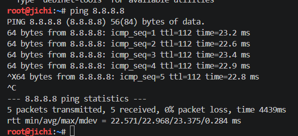

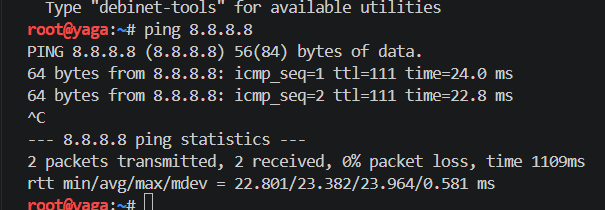

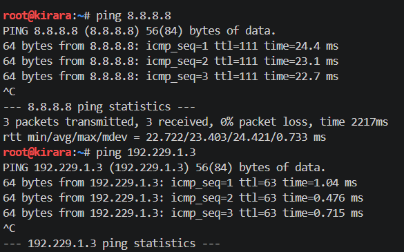

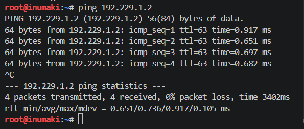

Jichi mengirim 5 paket ke `8.8.8.8` tanpa packet loss. Yaga dan kirara di Network 4 juga berhasil menjangkau `8.8.8.8`. Kirara menerima balasan dari shoko (`192.229.1.3`), dan inumaki berhasil melakukan ping ke utahime (`192.229.1.2`) dengan 0% packet loss.

### Hasil dan Analisis

Host di Network 4 dapat menjangkau internet karena jichi meneruskan paket (IP forwarding) dan menerjemahkan alamat sumber `192.229.4.x` melalui MASQUERADE pada eth0. Ping dari inumaki di Network 4 ke utahime di Network 1 memiliki TTL 63, yaitu TTL awal 64 dikurangi satu hop, yang menunjukkan paket melewati satu router yaitu jichi.

### Kesimpulan

Jichi berhasil dikonfigurasi sebagai router dengan IPv4 forwarding dan source NAT. Host infrastruktur memiliki IP statis sesuai network masing-masing dan dapat saling berkomunikasi antar network serta mengakses internet.

## Soal 2 - DHCP Server pada Tengen

Tengen, penjaga pusat distribusi di Data Center, harus mengambil alih pengalokasian alamat bagi wilayah yang membutuhkan konfigurasi dinamis. Konfigurasikan `isc-dhcp-server` pada `192.229.4.10`. Deklarasikan Network 4 (`192.229.4.0/24`) sebagai subnet lokal tanpa pool dinamis, lalu siapkan scope DHCP untuk Network 2 (`192.229.2.0/24`) dan Network 3 (`192.229.3.0/24`). Validasi konfigurasi dan pastikan service aktif tanpa error "No subnet declaration".

### Tujuan

- Memasang dan mengonfigurasi `isc-dhcp-server` pada tengen.
- Mendeklarasikan Network 4 sebagai subnet lokal tanpa pool.
- Menyiapkan scope DHCP untuk Network 2 dan Network 3.
- Memvalidasi konfigurasi dan memastikan service berjalan.

### Langkah Pengerjaan

#### A. Instalasi dan interface

```bash
apt-get update
apt-get install -y isc-dhcp-server
```

Interface yang melayani DHCP ditentukan di `/etc/default/isc-dhcp-server`:

```conf
INTERFACESv4="eth0"
INTERFACESv6=""
```

#### B. Konfigurasi subnet

Konfigurasi awal di `/etc/dhcp/dhcpd.conf`:

```conf
ddns-update-style none;
authoritative;
default-lease-time 600;
max-lease-time 7200;

# Network 4 (lokal, tanpa pool dinamis)
subnet 192.229.4.0 netmask 255.255.255.0 {
}

# Network 2 (Divisi A)
subnet 192.229.2.0 netmask 255.255.255.0 {
    range 192.229.2.10 192.229.2.35;
    option routers 192.229.2.1;
    option broadcast-address 192.229.2.255;
}

# Network 3 (Divisi B)
subnet 192.229.3.0 netmask 255.255.255.0 {
    range 192.229.3.10 192.229.3.89;
    option routers 192.229.3.1;
    option broadcast-address 192.229.3.255;
}
```

Deklarasi subnet Network 4 wajib ada karena interface tengen berada di subnet tersebut. Tanpa deklarasi itu, service gagal start dengan error "No subnet declaration for eth0". Scope ini kemudian dikembangkan pada soal 4 sampai 6.

#### C. Validasi

```bash
dhcpd -t -cf /etc/dhcp/dhcpd.conf
service isc-dhcp-server restart
service isc-dhcp-server status
ps aux | grep dhcpd
```

**Expected:** `dhcpd -t` tidak menampilkan error, service berstatus running, dan proses `dhcpd` berjalan pada `eth0`.

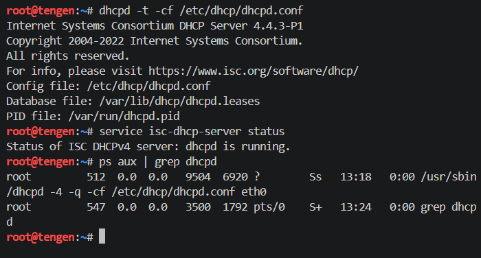

Screenshot menunjukkan `dhcpd -t` tanpa pesan error, status `dhcpd is running`, dan proses `/usr/sbin/dhcpd -4 -q -cf /etc/dhcp/dhcpd.conf eth0`.

### Hasil dan Analisis

Konfigurasi dinyatakan valid karena `dhcpd -t` tidak menampilkan error dan service berjalan. Pada tahap ini client Network 2 dan 3 belum dapat memperoleh alamat karena permintaan broadcast mereka belum diteruskan ke tengen. Hal tersebut dikerjakan melalui DHCP Relay pada soal 3.

### Kesimpulan

Tengen berhasil dikonfigurasi sebagai DHCP Server dengan Network 4 sebagai subnet lokal tanpa pool, serta scope untuk Network 2 dan Network 3.

## Soal 3 - DHCP Relay pada Jichi

Permintaan alamat dari Divisi A dan Divisi B tidak dapat menyeberangi subnet secara langsung. Konfigurasikan jichi sebagai DHCP Relay menuju tengen (`192.229.4.10`), menggunakan eth2 untuk Network 2 dan eth3 untuk Network 3. Buktikan bahwa client dari kedua subnet berhasil memperoleh lease melalui relay.

### Tujuan

- Mengonfigurasi jichi sebagai DHCP Relay menuju tengen.
- Membuktikan client Network 2 dan Network 3 memperoleh lease melalui relay.

### Langkah Pengerjaan

#### A. Konfigurasi relay pada jichi

```bash
export DEBIAN_FRONTEND=noninteractive
apt-get update
apt-get install -y isc-dhcp-relay
```

Konfigurasi di `/etc/default/isc-dhcp-relay`:

```conf
SERVERS="192.229.4.10"
INTERFACES="eth2 eth3 eth4"
OPTIONS=""
```

Eth2 dan eth3 menerima permintaan dari client Divisi A dan B, sedangkan eth4 menghadap ke tengen. Service kemudian dijalankan:

```bash
service isc-dhcp-relay restart
```

#### B. Pengujian dari client

Pada client Network 2 dan Network 3:

```bash
udhcpc -i eth0
ip a
ip route
```

**Expected:** client memperoleh lease dari server `192.229.4.10` dengan alamat dan gateway sesuai network masing-masing.


Ino (Network 3) memperoleh `192.229.3.10` dari server `192.229.4.10` dan dapat melakukan ping ke `8.8.8.8`. Ino memiliki default route via `192.229.3.1`. Itadori (Network 2) memperoleh `192.229.2.10/24` dengan default route via `192.229.2.1`.

### Hasil dan Analisis

Broadcast DHCPDISCOVER dari client tidak dapat melewati router. Relay pada jichi menerima broadcast tersebut dan meneruskannya sebagai unicast ke tengen dengan mengisi field `giaddr` menggunakan alamat interface jichi yang menerima request. Tengen memakai `giaddr` untuk memilih scope subnet yang sesuai, kemudian balasannya diteruskan relay ke client. Server `192.229.4.10` pada keluaran `udhcpc` membuktikan bahwa lease berasal dari tengen di Network 4.

### Kesimpulan

DHCP Relay pada jichi berhasil meneruskan permintaan client Network 2 dan Network 3 ke tengen, sehingga client memperoleh alamat dan gateway yang sesuai.

## Soal 4 - Pool DHCP Divisi A Berdasarkan MAC Address

Agar tim Dev dan Support di Divisi A menerima jatah alamat yang berbeda, atur dua pool DHCP pada Network 2. Tetapkan Pool 1 (`192.229.2.10 - 192.229.2.35`) untuk itadori dan fushiguro, serta Pool 2 (`192.229.2.70 - 192.229.2.95`) untuk zenin dan okkotsu. Rentang `192.229.2.36 - 192.229.2.69` tidak boleh dialokasikan. Karena seluruh client berada pada subnet yang sama, gunakan DHCP class berdasarkan MAC Address atau Client ID untuk memisahkan kedua kelompok.

### Tujuan

- Memisahkan client Divisi A menjadi dua kelompok menggunakan DHCP class berdasarkan MAC Address.
- Membuat Pool 1 dan Pool 2 sesuai rentang pada soal.
- Memastikan rentang `192.229.2.36 - 192.229.2.69` tidak dialokasikan.

### Langkah Pengerjaan

#### A. Class dan pool pada tengen

Karena itadori, fushiguro, zenin, dan okkotsu berada pada subnet yang sama, pembeda keduanya adalah MAC Address. Setiap `pool` dibatasi dengan `allow members of` sehingga hanya kelas tertentu yang dapat memakainya.

```conf
class "pool1" {
    match if substring(hardware, 1, 6) = 02:42:17:b9:c8:00 or
             substring(hardware, 1, 6) = 02:42:a2:57:11:00;
}

class "pool2" {
    match if substring(hardware, 1, 6) = 02:42:86:ff:fd:00 or
             substring(hardware, 1, 6) = 02:42:70:fc:e9:00;
}

subnet 192.229.2.0 netmask 255.255.255.0 {
    option routers 192.229.2.1;
    option broadcast-address 192.229.2.255;

    pool {
        allow members of "pool1";
        range 192.229.2.10 192.229.2.35;
    }

    pool {
        allow members of "pool2";
        range 192.229.2.70 192.229.2.95;
    }
}
```

Rentang `192.229.2.36 - 192.229.2.69` tidak tercakup oleh `range` mana pun sehingga tidak pernah dialokasikan.

#### B. Validasi dan pengujian

Di tengen:

```bash
dhcpd -t -cf /etc/dhcp/dhcpd.conf
service isc-dhcp-server restart
grep -E "range|allow members" /etc/dhcp/dhcpd.conf
```

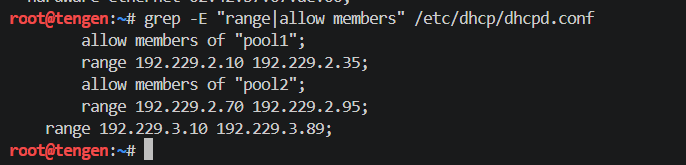

Di masing-masing client Divisi A:

```bash
udhcpc -i eth0
```

**Expected:** itadori dan fushiguro memperoleh alamat dari Pool 1, sedangkan zenin dan okkotsu dari Pool 2.


### Hasil dan Analisis

| Client    | IP             | Pool   |
| --------- | -------------- | ------ |
| itadori   | `192.229.2.10` | Pool 1 |
| fushiguro | `192.229.2.11` | Pool 1 |
| zenin     | `192.229.2.70` | Pool 2 |
| okkotsu   | `192.229.2.71` | Pool 2 |

Seluruh lease diberikan oleh server `192.229.4.10` dengan lease time 600 detik. Zenin dan okkotsu langsung memperoleh alamat dari awal Pool 2 (`.2.70` dan `.2.71`) meskipun alamat di Pool 1 masih tersedia, sehingga pemisahan berdasarkan class berhasil. Tidak ada client yang memperoleh alamat pada rentang `192.229.2.36 - 192.229.2.69`.

### Kesimpulan

Pool DHCP Network 2 berhasil dipisahkan menggunakan class berdasarkan MAC Address. Itadori dan fushiguro memperoleh alamat dari Pool 1, sedangkan zenin dan okkotsu dari Pool 2, dan rentang `.2.36` sampai `.2.69` tidak dialokasikan.

## Soal 5 - Short Lease, Long Lease, dan DHCP Options pada Network 3

Setiap tim lapangan memiliki durasi operasi yang berbeda. Pada Network 3, berikan short lease 30 menit (1800 detik) kepada ino dan kusakabe, serta long lease 12 jam (43200 detik) kepada miwa. Gunakan pool short lease `192.229.3.10 - 192.229.3.89` dan pool long lease `192.229.3.100 - 192.229.3.199`. Sesuaikan `default-lease-time` dan `max-lease-time` untuk setiap kelas client. Berikan pula DHCP options berupa DNS `192.229.1.2` dan `192.229.1.3`, serta domain-search `K-36.com`.

### Tujuan

- Memisahkan client Network 3 menjadi kelas short lease dan long lease berdasarkan MAC Address.
- Menetapkan lease time 1800 detik untuk ino dan kusakabe, serta 43200 detik untuk miwa.
- Membuat dua pool terpisah sesuai rentang pada soal.
- Memberikan DHCP options DNS dan domain-search kepada client.

### Langkah Pengerjaan

#### A. Class dan pool pada tengen

Karena seluruh client Network 3 berada pada subnet yang sama, pembeda antar kelompok adalah MAC Address. Lease time dituliskan di dalam masing-masing `class`, sehingga tiap kelas memiliki `default-lease-time` dan `max-lease-time` sendiri. Nilai `max-lease-time` disamakan dengan `default-lease-time` agar durasi sesuai soal.

```conf
option domain-name-servers 192.229.1.2, 192.229.1.3;
option domain-search "K-36.com";

class "short" {
    match if substring(hardware, 1, 6) = 02:42:b7:07:ae:00 or
             substring(hardware, 1, 6) = 02:42:a0:79:d9:00;
    default-lease-time 1800;
    max-lease-time 1800;
}

class "long" {
    match if substring(hardware, 1, 6) = 02:42:f3:7b:62:00;
    default-lease-time 43200;
    max-lease-time 43200;
}

subnet 192.229.3.0 netmask 255.255.255.0 {
    option routers 192.229.3.1;
    option broadcast-address 192.229.3.255;

    pool {
        allow members of "short";
        range 192.229.3.10 192.229.3.89;
    }

    pool {
        allow members of "long";
        range 192.229.3.100 192.229.3.199;
    }
}
```

Opsi DNS dan domain-search diletakkan pada level global agar berlaku untuk seluruh subnet, termasuk Network 2.

#### B. Validasi konfigurasi

```bash
dhcpd -t -cf /etc/dhcp/dhcpd.conf
service isc-dhcp-server restart
grep -E "range|lease-time|domain-name-servers|domain-search" /etc/dhcp/dhcpd.conf
```

**Expected:** `dhcpd -t` tidak menampilkan error, lalu hasil `grep` menampilkan lease time 1800 dan 43200, dua range Network 3, serta opsi DNS dan domain-search.


Screenshot menunjukkan lease time global 600 dan 7200, opsi DNS `192.229.1.2` dan `192.229.1.3`, domain-search `K-36.com`, range pool Network 2, lease time 1800 dan 43200 pada kelas short dan long, serta range `192.229.3.10 - 192.229.3.89` dan `192.229.3.100 - 192.229.3.199`.

### Hasil dan Analisis

Konfigurasi memisahkan client Network 3 ke dalam dua kelas. Kelas `short` hanya boleh memakai pool `.3.10` sampai `.3.89` dengan lease 30 menit, sedangkan kelas `long` hanya boleh memakai pool `.3.100` sampai `.3.199` dengan lease 12 jam. Rentang `.3.90` sampai `.3.99` sengaja tidak dimasukkan ke pool mana pun dan dipakai untuk reservasi alamat tetap pada soal berikutnya.

### Kesimpulan

Tengen berhasil dikonfigurasi dengan dua kelas client berdasarkan MAC Address, masing-masing dengan pool dan lease time sendiri, serta DHCP options DNS dan domain-search yang berlaku untuk seluruh client.

## Soal 6 - Fixed Address untuk Kugisaki

Kugisaki ditetapkan sebagai personel VIP yang harus mempertahankan alamat yang sama setiap kali terhubung. Buat DHCP static lease berdasarkan MAC Address client tersebut dengan fixed address `192.229.3.99`. Pastikan alamat ini berada di luar seluruh pool dinamis, validasi konfigurasi server, lalu renew lease pada client. Buktikan bahwa alamat yang diterima sesuai dengan reservasi.

### Tujuan

- Membuat reservasi alamat berdasarkan MAC Address untuk kugisaki.
- Memastikan `192.229.3.99` berada di luar pool short dan long.
- Membuktikan kugisaki menerima alamat sesuai reservasi setelah renew lease.

### Langkah Pengerjaan

#### A. Blok host pada tengen

```conf
host kugisaki {
    hardware ethernet 02:42:b0:d6:3f:00;
    fixed-address 192.229.3.99;
}
```

Alamat `192.229.3.99` berada di antara akhir pool short (`.3.89`) dan awal pool long (`.3.100`), sehingga tidak masuk ke pool dinamis mana pun.

#### B. Validasi dan renew lease

Di tengen:

```bash
dhcpd -t -cf /etc/dhcp/dhcpd.conf
service isc-dhcp-server restart
```

Di kugisaki:

```bash
udhcpc -i eth0
ip a
```

**Expected:** kugisaki memperoleh `192.229.3.99` dari server `192.229.4.10`.

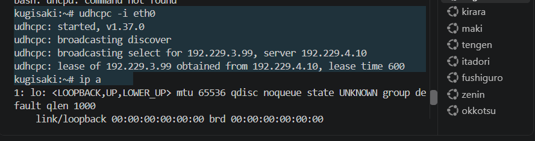

Screenshot menunjukkan kugisaki memperoleh lease `192.229.3.99` dari server `192.229.4.10`.

### Hasil dan Analisis

Kugisaki tidak termasuk kelas `short` maupun `long`, sehingga ia tidak dapat mengambil alamat dari pool dinamis dan hanya menerima alamat dari reservasi. Lease time yang muncul adalah 600 detik karena kugisaki memakai nilai global `default-lease-time`. Alamat yang diterima tetap `192.229.3.99` setiap kali client meminta lease.

### Kesimpulan

Reservasi berbasis MAC Address berhasil membuat kugisaki selalu menerima `192.229.3.99`, yang berada di luar seluruh pool dinamis.

## Soal 7 - Verifikasi Konfigurasi Client Divisi A dan Divisi B

Setelah aturan alokasi diterapkan, pastikan setiap client menerima konfigurasi jaringan sesuai wilayahnya: subnet mask `255.255.255.0` (/24), gateway dan broadcast address yang benar, DNS `192.229.1.2` serta `192.229.1.3`, dan domain-search yang ditentukan. Periksa IP address dan routing seluruh client Divisi A dan Divisi B, kemudian cocokkan lease dengan `/var/lib/dhcp/dhcpd.leases` pada tengen. Pastikan tidak ada alamat yang bertabrakan atau berada di luar kebijakan pool.

### Tujuan

- Memeriksa IP address, broadcast, dan subnet mask client Divisi A dan Divisi B.
- Memeriksa default gateway pada tabel routing client.
- Memeriksa DNS dan domain-search pada `/etc/resolv.conf`.

### Langkah Pengerjaan

Perintah berikut dijalankan pada masing-masing client:

```bash
ip a
ip route
cat /etc/resolv.conf
```

#### A. IP address

**Expected:** client Network 2 memperoleh alamat `192.229.2.x/24` dengan broadcast `192.229.2.255`. Client Network 3 memperoleh alamat `192.229.3.x/24` dengan broadcast `192.229.3.255`.

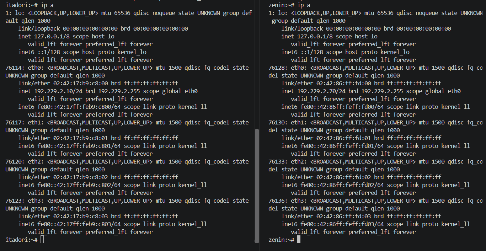


| Client   | Network | IP                 | Broadcast       | Pool                     |
| -------- | ------- | ------------------ | --------------- | ------------------------ |
| itadori  | 2       | `192.229.2.10/24`  | `192.229.2.255` | Pool 1                   |
| zenin    | 2       | `192.229.2.70/24`  | `192.229.2.255` | Pool 2                   |
| ino      | 3       | `192.229.3.10/24`  | `192.229.3.255` | Short lease              |
| kugisaki | 3       | `192.229.3.99/24`  | `192.229.3.255` | Reservasi (di luar pool) |
| miwa     | 3       | `192.229.3.100/24` | `192.229.3.255` | Long lease               |

#### B. Routing

**Expected:** client Network 2 memiliki default route via `192.229.2.1`, sedangkan client Network 3 via `192.229.3.1`.


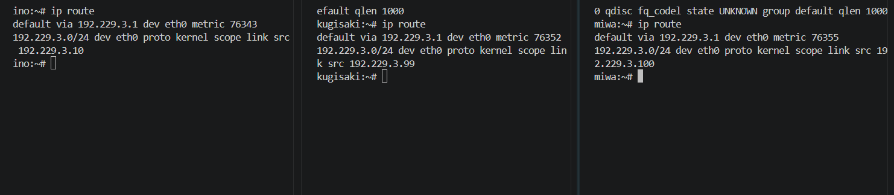

Itadori memiliki default route via `192.229.2.1`. Ino, kugisaki, dan miwa memiliki default route via `192.229.3.1`.

#### C. DNS dan domain-search

**Expected:** `/etc/resolv.conf` berisi `search K-36.com`, `nameserver 192.229.1.2`, dan `nameserver 192.229.1.3`.

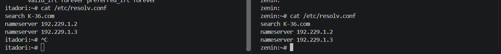


Seluruh client yang diperiksa menerima domain-search `K-36.com` serta kedua DNS server. Pada miwa, lease yang diterima menampilkan waktu 37096 detik, yaitu sisa masa berlaku dari lease 12 jam.

### Hasil dan Analisis

Setiap client menerima alamat sesuai pool kelompoknya, dengan subnet mask /24 dan broadcast yang benar untuk network masing-masing. Default gateway mengarah ke interface jichi pada network tersebut, dan DNS serta domain-search diterima dari opsi global DHCP server.

### Kesimpulan

Client Divisi A dan Divisi B menerima konfigurasi jaringan yang sesuai dengan wilayahnya, mencakup IP address, broadcast, gateway, DNS, dan domain-search.

## Soal 8 - Packet Capture Proses DHCP

Sebelum Curtain dibuka kembali, buktikan bahwa proses pemberian alamat berjalan sesuai protokol. Lakukan packet capture saat salah satu client Network 2 atau Network 3 meminta lease baru. Gunakan tcpdump pada tengen atau jalur menuju Data Center untuk menunjukkan urutan DHCPDISCOVER → DHCPOFFER → DHCPREQUEST → DHCPACK. Identifikasi alamat server, alamat yang diberikan, lease time, dan field giaddr. Pastikan nilai giaddr sesuai dengan interface jichi yang menerima request dari subnet client.

### Tujuan

- Menangkap paket DHCP menggunakan tcpdump pada tengen.
- Menunjukkan urutan DISCOVER, OFFER, REQUEST, dan ACK.
- Mengidentifikasi alamat server, alamat yang diberikan, lease time, dan `giaddr`.

### Langkah Pengerjaan

#### A. Menjalankan capture pada tengen

```bash
tcpdump -i eth0 -n -vvv -l -c 4 port 67 or port 68 | grep -E "BOOTP|DHCP-Message|Gateway-IP|Client-Ethernet-Address|Your-IP|Server-ID|Lease-Time"
```

Port 67 dan 68 adalah port DHCP server dan client. Opsi `-vvv` menampilkan detail field DHCP, `-c 4` menghentikan capture setelah empat paket, dan `grep` menyaring baris yang dibutuhkan saja. Capture dilakukan pada `eth0` tengen, yaitu jalur menuju Data Center.

#### B. Meminta lease baru dari itadori

Pada itadori (Network 2), alamat lama dihapus agar proses dimulai dari awal sehingga keempat paket muncul, bukan hanya perpanjangan lease:

```bash
ip addr flush dev eth0
udhcpc -i eth0
```

**Expected:** capture menampilkan empat paket DHCP berurutan, yaitu Discover, Offer, Request, dan ACK, dengan `Gateway-IP` bernilai `192.229.2.1`.

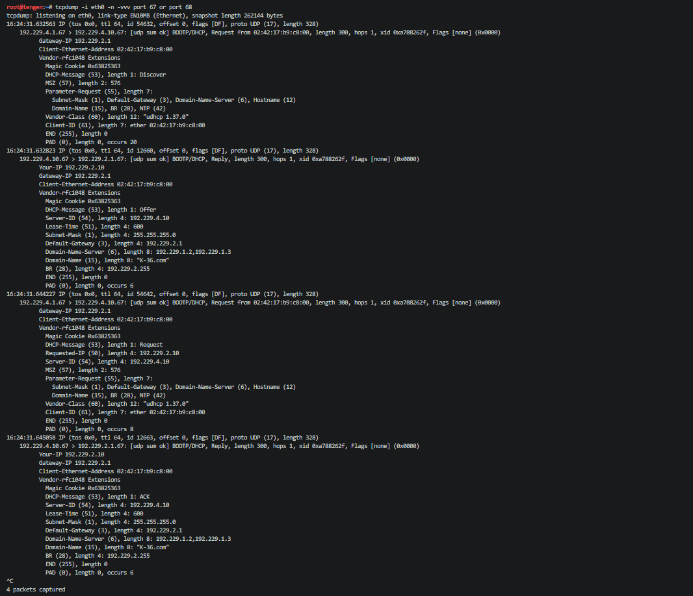

### Hasil dan Analisis

| No  | Paket    | Sumber            | Tujuan            | Isi penting                                                        |
| --- | -------- | ----------------- | ----------------- | ------------------------------------------------------------------ |
| 1   | Discover | `192.229.4.1:67`  | `192.229.4.10:67` | `Gateway-IP 192.229.2.1`, MAC client `02:42:17:b9:c8:00`           |
| 2   | Offer    | `192.229.4.10:67` | `192.229.2.1:67`  | `Your-IP 192.229.2.10`, `Server-ID 192.229.4.10`, `Lease-Time 600` |
| 3   | Request  | `192.229.4.1:67`  | `192.229.4.10:67` | `Requested-IP 192.229.2.10`, `Server-ID 192.229.4.10`              |
| 4   | ACK      | `192.229.4.10:67` | `192.229.2.1:67`  | `Your-IP 192.229.2.10`, `Lease-Time 600`                           |

Informasi yang diminta soal:

| Informasi             | Field pada tcpdump | Nilai          |
| --------------------- | ------------------ | -------------- |
| Alamat server         | `Server-ID`        | `192.229.4.10` |
| Alamat yang diberikan | `Your-IP`          | `192.229.2.10` |
| Lease time            | `Lease-Time`       | `600` detik    |
| giaddr                | `Gateway-IP`       | `192.229.2.1`  |

Urutan DISCOVER, OFFER, REQUEST, dan ACK muncul lengkap dengan nilai `xid` yang sama pada keempat paket, yang menandakan semuanya milik satu transaksi. Alamat MAC client pada capture, yaitu `02:42:17:b9:c8:00`, adalah milik itadori. Paket client tidak sampai ke tengen secara langsung. Paket Discover dan Request berasal dari `192.229.4.1`, yaitu interface eth4 jichi yang menghadap ke tengen, dengan `hops 1` yang menandakan paket telah melewati satu relay.

Field `giaddr` bernilai `192.229.2.1`, yaitu alamat interface eth2 jichi yang menerima request dari Network 2. Nilai ini sesuai dengan interface jichi untuk subnet client. Tengen memakainya untuk memilih scope `192.229.2.0/24`, sehingga alamat yang ditawarkan berada pada Pool 1. Balasan Offer dan ACK dikirim tengen ke `giaddr` (`192.229.2.1`), lalu diteruskan oleh relay ke client. Paket Offer dan ACK juga memuat subnet mask `255.255.255.0`, gateway `192.229.2.1`, DNS `192.229.1.2` dan `192.229.1.3`, serta broadcast `192.229.2.255`.

### Kesimpulan

Proses pemberian alamat berjalan sesuai protokol DHCP. Itadori memperoleh `192.229.2.10` dari server `192.229.4.10` dengan lease time 600 detik melalui relay pada jichi, dan field `giaddr` bernilai `192.229.2.1` sesuai interface eth2 jichi yang menerima request dari Network 2.

## Soal 9 - Simulasi Gangguan DHCP Relay

Sebuah gangguan memutus jalur relay dan membuat permintaan alamat tidak sampai ke Data Center. Hentikan service DHCP Relay pada jichi, lalu paksa salah satu client di Network 2 atau Network 3 meminta lease baru dan catat gejalanya. Pulihkan service relay, ulangi permintaan DHCP, lalu buktikan bahwa client kembali memperoleh alamat dari pool yang benar dengan gateway semula.

### Tujuan

- Menghentikan DHCP Relay pada jichi dan mencatat gejala pada client.
- Memulihkan relay dan membuktikan client kembali memperoleh lease dari pool yang benar.

### Langkah Pengerjaan

#### A. Hentikan relay dan catat gejala

Di jichi:

```bash
service isc-dhcp-relay stop
```

Di itadori (Network 2), hapus alamat lama lalu minta lease baru:

```bash
killall udhcpc
ip addr flush dev eth0
udhcpc -i eth0
```

**Expected:** client terus mengirim `broadcasting discover` tanpa menerima offer dan berakhir dengan pesan `udhcpc failed to get a DHCP lease`.

#### B. Pulihkan relay

Di jichi:

```bash
service isc-dhcp-relay start
```

Di itadori:

```bash
udhcpc -i eth0
ip route
```

**Expected:** itadori memperoleh alamat dari Pool 1 dengan gateway `192.229.2.1`.

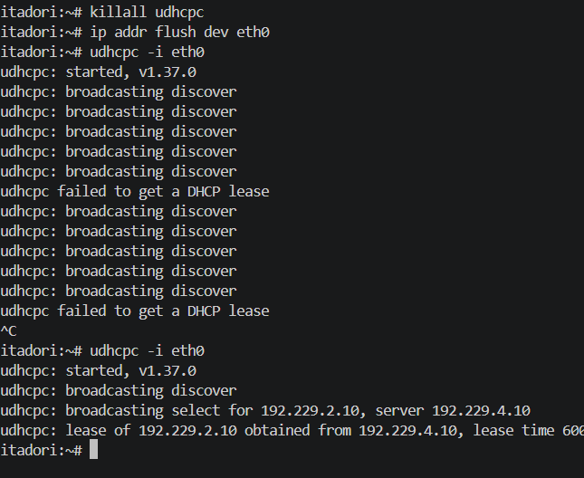

Pada bagian atas screenshot, itadori mengirim `broadcasting discover` berulang kali dan menampilkan `udhcpc failed to get a DHCP lease`. Setelah relay dipulihkan, itadori memperoleh `192.229.2.10` dari server `192.229.4.10` dengan lease time 600 detik.

### Hasil dan Analisis

Broadcast DHCPDISCOVER tidak dapat melewati router, sehingga tanpa relay di jichi permintaan client tidak pernah sampai ke tengen dan tidak ada DHCPOFFER yang kembali. Setelah relay aktif, permintaan diteruskan ke `192.229.4.10` dan itadori memperoleh alamat `192.229.2.10`, yang berada pada Pool 1 (`192.229.2.10 - 192.229.2.35`).

### Kesimpulan

DHCP Relay pada jichi menjadi syarat agar client di Network 2 dan Network 3 dapat memperoleh lease dari tengen. Setelah relay dipulihkan, client kembali memperoleh alamat dari pool yang benar.

## Soal 10 - Autostart DHCP Server dan DHCP Relay

Setelah gangguan Shibuya tertangani, pastikan pemulihan bertahan setelah restart. Aktifkan autostart DHCP Server pada tengen dan DHCP Relay pada jichi, lalu restart kedua node. Verifikasi status layanan, IP, gateway, lease, dan konektivitas client Network 2 dan 3. Pastikan kebijakan Pool 1, Pool 2, short lease, long lease, dan fixed address tetap berlaku.

### Tujuan

- Mengaktifkan autostart DHCP Server pada tengen dan DHCP Relay pada jichi.
- Memastikan layanan dan konektivitas client tetap berfungsi setelah node di-restart.
- Memastikan kebijakan alokasi alamat tetap berlaku setelah restart.

### Langkah Pengerjaan

#### A. Autostart melalui `/root/.bashrc`

Script konfigurasi dipanggil dari `/root/.bashrc` sehingga dijalankan otomatis setiap kali console node dibuka setelah restart.

Pada tengen, `soal2.sh` memasang dan menyalakan DHCP Server dengan konfigurasi lengkap:

```bash
echo 'bash /root/soal2.sh' >> /root/.bashrc
```

Pada jichi, `init.sh` mengaktifkan IP forwarding dan NAT, lalu `soal3.sh` menyalakan DHCP Relay:

```bash
echo 'bash /root/init.sh' >> /root/.bashrc
echo 'bash /root/soal3.sh' >> /root/.bashrc
```

#### B. Restart node

Tengen dan jichi di-restart dari GNS3. Console jichi dibuka lebih dulu agar NAT sudah aktif saat tengen menjalankan `apt-get update`. Setelah itu tidak ada service yang dinyalakan secara manual.

#### C. Verifikasi dari client

Pada itadori (Network 2), alamat lama dihapus agar client harus meminta lease baru dari awal:

```bash
ip addr flush dev eth0
udhcpc -i eth0
ip route
```

**Expected:** itadori memperoleh alamat dari Pool 1 yang diberikan server `192.229.4.10`, dengan lease time 600 detik dan default gateway `192.229.2.1`.

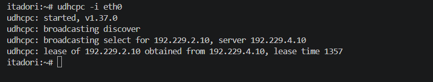

Itadori memperoleh `192.229.2.10` dari server `192.229.4.10` dengan lease time 600 detik, dan default route mengarah ke `192.229.2.1`.

### Hasil dan Analisis

Konfigurasi interface tersimpan di file sehingga IP node tetap ada setelah restart, tetapi proses `dhcpd` dan `dhcrelay`, nilai `ip_forward`, serta rule NAT hanya hidup di memori dan hilang saat node mati. Karena itu script dipanggil dari `/root/.bashrc` agar semuanya dinyalakan kembali saat console dibuka.

Permintaan lease dari itadori hanya dapat dijawab jika DHCP Relay pada jichi meneruskan broadcast ke tengen dan DHCP Server pada tengen aktif. Keberhasilan `udhcpc` setelah restart, tanpa ada service yang dinyalakan manual, membuktikan kedua layanan berjalan kembali secara otomatis. Alamat `192.229.2.10` berada pada Pool 1 (`192.229.2.10 - 192.229.2.35`) sesuai kebijakan. Kebijakan Pool 2, short lease, long lease, dan fixed address tetap berlaku karena `soal2.sh` menulis ulang seluruh konfigurasi DHCP, termasuk class, pool, lease time, dan reservasi alamat, setiap kali dijalankan.

### Kesimpulan

DHCP Server pada tengen dan DHCP Relay pada jichi menyala kembali secara otomatis setelah restart melalui `/root/.bashrc`. Client Network 2 kembali memperoleh alamat dari pool yang benar dengan gateway semula.

## Soal 11 — DNS Master dan DNS Slave

Utahime dan Shoko ditugaskan membangun sistem penamaan domain resmi agar seluruh pos tidak perlu menghafal alamat IP mentah. Konfigurasikan BIND9 pada **utahime** sebagai **DNS Master** dan **shoko** sebagai **DNS Slave** untuk mengelola domain **jujutsu.<xxxx>.com**. Atur SOA record, NS delegasi untuk kedua server, dan terapkan **allow-transfer** dari Master ke Slave. Pastikan file zona berhasil tersinkronisasi otomatis ke shoko saat nomor serial di utahime dinaikkan, lalu buktikan dengan melakukan query **dig** ke kedua server dari salah satu client.

### Tujuan

- Mengonfigurasi Utahime sebagai DNS Master dan Shoko sebagai DNS Slave.
- Membuat record SOA dan NS untuk domain `jujutsu.k-36.com`.
- Mengatur transfer zona dari Master ke Slave.
- Membuktikan sinkronisasi serial zona dan menguji query DNS dari client.

### Langkah Pengerjaan

#### A. DNS Master — Utahime

IP Utahime adalah `192.229.1.2`, sedangkan IP Shoko adalah `192.229.1.3`.

Konfigurasi zona di `/etc/bind/named.conf.local`:

```conf
zone "jujutsu.k-36.com" {
    type master;
    file "/etc/bind/db.jujutsu.k-36.com";
    allow-transfer { 192.229.1.3; };
    also-notify { 192.229.1.3; };
    notify yes;
};
```

File `/etc/bind/db.jujutsu.k-36.com` berisi record SOA, NS untuk kedua DNS, dan A record untuk alamat server.

```dns
$TTL 86400
@ IN SOA ns1.jujutsu.k-36.com. hostmaster.jujutsu.k-36.com. (
    2026101401
    3600
    900
    1209600
    86400
)

@   IN NS ns1.jujutsu.k-36.com.
@   IN NS ns2.jujutsu.k-36.com.

ns1 IN A 192.229.1.2
ns2 IN A 192.229.1.3
```

Validasi konfigurasi:

```bash
named-checkconf -z
named-checkzone jujutsu.k-36.com /etc/bind/db.jujutsu.k-36.com
```

**Expected:** zona berhasil dimuat dan hasil `named-checkzone` berakhir dengan `OK`.

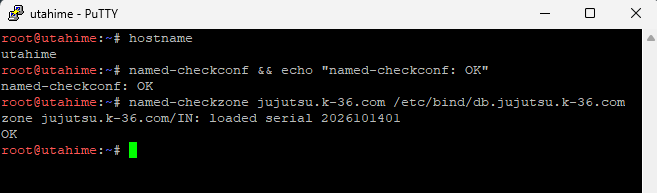

Periksa konfigurasi transfer:

```bash
cat /etc/bind/named.conf.local
```

**Expected:** terlihat `type master` dan `allow-transfer { 192.229.1.3; };`.

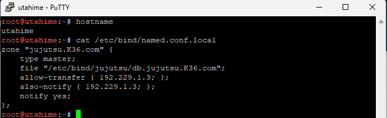

#### B. DNS Slave — Shoko

Konfigurasi di `/etc/bind/named.conf.local`:

```conf
zone "jujutsu.k-36.com" {
    type slave;
    file "/var/cache/bind/db.jujutsu.k-36.com";
    masters { 192.229.1.2; };
};
```

Validasi konfigurasi:

```bash
named-checkconf
```

Periksa file zona hasil transfer:

```bash
ls -lh /var/cache/bind/
```

**Expected:** file `db.jujutsu.k-36.com` tersedia setelah transfer berhasil.

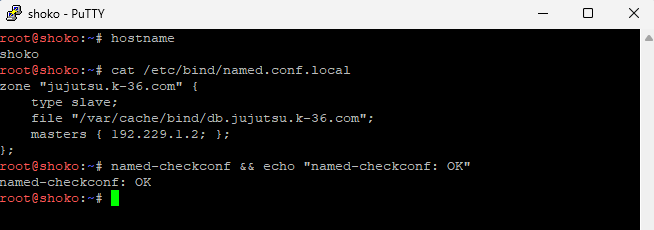 <br>
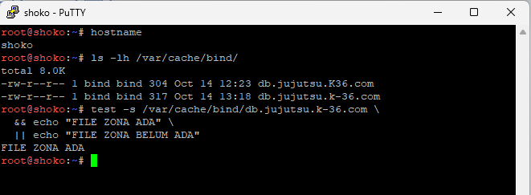

#### C. Pengujian sinkronisasi serial

Di Utahime, periksa serial awal:

```bash
dig @192.229.1.2 jujutsu.k-36.com SOA +noall +answer
```

Serial awal: `2026101401`.

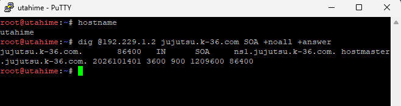

Setelah memastikan serial saat ini benar-benar `2026101401`, naikkan menjadi `2026101402` pada file zona dan validasi kembali:

```bash
sed -i 's/2026101401/2026101402/' /etc/bind/db.jujutsu.k-36.com
named-checkzone jujutsu.k-36.com /etc/bind/db.jujutsu.k-36.com
```

**Expected:** hasil validasi menampilkan serial `2026101402` dan `OK`.

Setelah validasi berhasil, muat ulang zona Master menggunakan mekanisme BIND yang berjalan pada node, kemudian periksa kembali:

```bash
dig @192.229.1.2 jujutsu.k-36.com SOA +noall +answer
```

**Expected:** serial Master berubah menjadi `2026101402`.

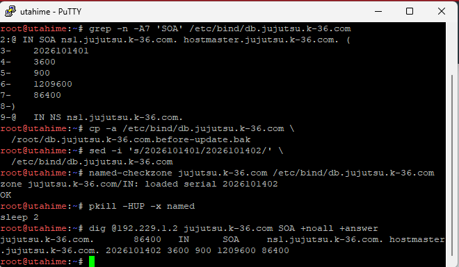

Di Shoko, periksa serial:

```bash
dig @192.229.1.3 jujutsu.k-36.com SOA +noall +answer
```

**Expected:** serial Shoko ikut menjadi `2026101402`.

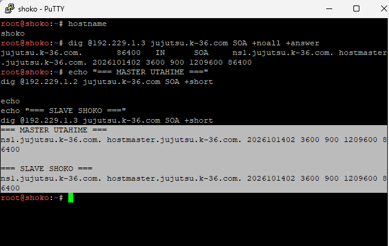

#### D. Pengujian dari client

Dari client yang sudah terhubung ke jaringan, jalankan:

```bash
dig @192.229.1.2 jujutsu.k-36.com SOA +noall +answer
dig @192.229.1.3 jujutsu.k-36.com SOA +noall +answer
```

**Expected:** kedua server memberikan jawaban SOA dengan serial yang sama. Client harus memiliki alamat IPv4 dan rute yang benar agar dapat menjangkau Network 1.

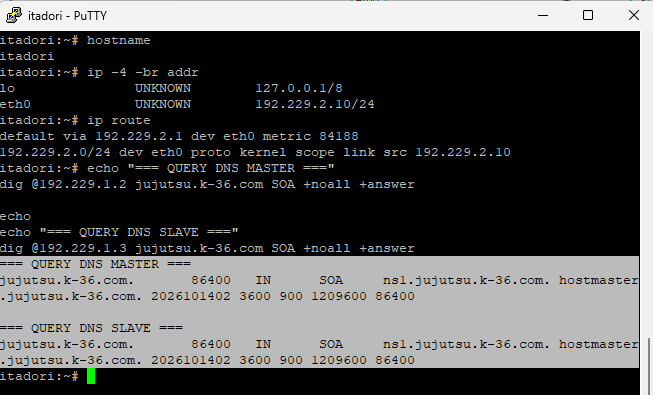

### Hasil dan Analisis

Konfigurasi dinyatakan berhasil apabila Utahime dapat melayani zona `jujutsu.k-36.com`, Shoko menerima file zona melalui transfer DNS, dan serial pada kedua server sama setelah pembaruan. Query `dig` dari client juga harus berhasil pada kedua server.

Jika file zona belum tersedia atau serial Shoko belum berubah, periksa log BIND dan aturan `allow-transfer` sebelum menyatakan pengujian berhasil.

### Kesimpulan

Pada praktikum ini, Utahime dikonfigurasi sebagai DNS Master dan Shoko sebagai DNS Slave. Record SOA dan NS digunakan untuk mendefinisikan zona, sedangkan `allow-transfer` membatasi penerima transfer zona. Keberhasilan sinkronisasi dibuktikan dengan kesamaan serial SOA setelah pembaruan dan keberhasilan query DNS dari client.

## Soal 12 — A Record, CNAME, Reverse DNS (PTR), dan DNS Forwarder

Peta domain harus memetakan pintu masuk utama dan tetap bisa mencari alamat di luar kawasan Shibuya. Pada **utahime**, buat A record `jujutsu.<xxxx>.com` yang mengarah ke gojo, serta CNAME `www` yang merujuk ke domain utama tersebut. Buat pula Reverse DNS (zona PTR) untuk melacak IP gojo kembali ke domain resminya, dan aktifkan fitur DNS Forwarder pada BIND9 mengarah ke IP gateway internet (`192.168.122.1`). Uji dari client dengan `dig` untuk mengecek CNAME, PTR, dan buktikan client tetap bisa melakukan ping ke domain internet seperti `google.com`.

### Tujuan

- Memetakan domain utama `jujutsu.k-36.com` ke IP Gojo menggunakan A record.
- Membuat alias `www` menggunakan CNAME.
- Membuat reverse DNS (PTR) untuk IP Gojo.
- Mengaktifkan DNS Forwarder ke `192.168.122.1` untuk query domain eksternal.
- Membuktikan hasil DNS dari client melalui `dig` dan menguji resolusi serta konektivitas `google.com`.

### Informasi konfigurasi

| Komponen             | Nilai                    |
| -------------------- | ------------------------ |
| Kelompok             | K-36                     |
| Domain               | `jujutsu.k-36.com`       |
| Utahime (DNS Master) | `192.229.1.2`            |
| Shoko (DNS Slave)    | `192.229.1.3`            |
| Gojo                 | `192.229.1.4`            |
| DNS Forwarder        | `192.168.122.1`          |
| Reverse zone         | `1.229.192.in-addr.arpa` |

### Langkah pengerjaan

#### A. Utahime — DNS Master

Salin script `soal-12.sh` ke `/root/` pada node Utahime, kemudian jalankan:

```bash
chmod +x /root/soal-12.sh
/root/soal-12.sh
```

Script mengatur DNS forwarder ke `192.168.122.1`, mendeklarasikan forward zone dan reverse zone, membuat A record untuk domain utama, CNAME `www`, dan record PTR untuk IP Gojo. Script lalu memvalidasi konfigurasi dan menampilkan hasil query awal.

Validasi manual yang digunakan:

```bash
named-checkconf -z
named-checkzone jujutsu.k-36.com /etc/bind/db.jujutsu.k-36.com
named-checkzone 1.229.192.in-addr.arpa /etc/bind/db.192.229.1
```

**Expected:** `named-checkconf -z` tidak menampilkan error; kedua perintah `named-checkzone` memuat zona masing-masing dan berakhir dengan `OK`.

#### B. Shoko — DNS Slave

Setelah Utahime berhasil, salin `soal-12.sh` ke `/root/` pada node Shoko, kemudian jalankan:

```bash
chmod +x /root/soal-12.sh
/root/soal-12.sh
```

Script mengatur forward zone dan reverse zone sebagai Slave dengan Utahime (`192.229.1.2`) sebagai Master, lalu mengaktifkan konfigurasi DNS forwarder. File zona Slave diharapkan diterima melalui zone transfer dan berada di `/var/cache/bind/`.

Periksa dengan:

```bash
named-checkconf
ls -lh /var/cache/bind/
```

#### C. Pengujian DNS dan forwarder dari client

Jalankan tes berikut pada client yang sudah memiliki IPv4, gateway, dan koneksi ke Network 1. Contoh menggunakan Utahime sebagai server DNS yang ditanya.

**A record:**

```bash
dig @192.229.1.2 jujutsu.k-36.com A +noall +answer
```

Expected: record A mengembalikan IP Gojo, yaitu `192.229.1.4`.

**CNAME `www`:**

```bash
dig @192.229.1.2 www.jujutsu.k-36.com CNAME +noall +answer
```

Expected: CNAME `www.jujutsu.k-36.com.` mengarah ke `jujutsu.k-36.com.`.

**PTR Gojo:**

```bash
dig @192.229.1.2 -x 192.229.1.4 +noall +answer
```

Expected: PTR untuk `4.1.229.192.in-addr.arpa.` mengarah ke `jujutsu.k-36.com.`.

**DNS forwarder dan ping:**

```bash
dig @192.229.1.2 google.com A +noall +answer
ping -c 4 google.com
```

Expected: query `google.com` mengembalikan satu atau lebih alamat IP. Ping harus dapat melakukan resolusi nama; balasan ICMP bergantung pada konektivitas dan apakah host tujuan mengizinkan ICMP.

### Dokumentasi screenshot

#### Validasi DNS dan konfigurasi forwarder

**Node:** Utahime. Screenshot harus menampilkan `hostname`, hasil `named-checkconf -z`, hasil validasi forward dan reverse zone, serta konfigurasi forwarder.

Perintah:

```bash
hostname
named-checkconf -z
named-checkzone jujutsu.k-36.com /etc/bind/db.jujutsu.k-36.com
named-checkzone 1.229.192.in-addr.arpa /etc/bind/db.192.229.1
grep -E 'forwarders|forward first' /etc/bind/named.conf.options
```

Expected: kedua zona valid dengan hasil `OK`; forwarder menunjukkan `192.168.122.1`.

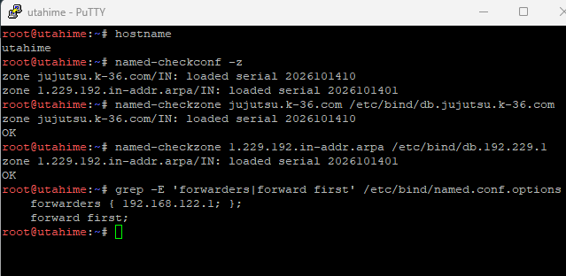

#### Pengujian A record, CNAME, dan PTR dari client

**Node:** client yang sudah terkoneksi. Screenshot harus menampilkan hasil ketiga query berikut.

```bash
hostname
dig @192.229.1.2 jujutsu.k-36.com A +noall +answer
dig @192.229.1.2 www.jujutsu.k-36.com CNAME +noall +answer
dig @192.229.1.2 -x 192.229.1.4 +noall +answer
```

Expected: A record mengarah ke IP Gojo; CNAME `www` mengarah ke domain utama; PTR IP Gojo mengarah ke `jujutsu.k-36.com.`.

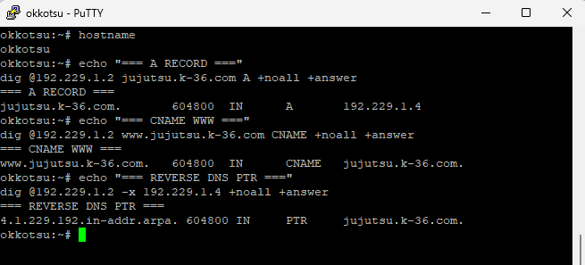

#### Pengujian DNS forwarder dan ping Google

**Node:** client yang sama. Screenshot harus menampilkan query ke `google.com` dan hasil ping.

```bash
dig @192.229.1.2 google.com A +noall +answer
ping -c 4 google.com
```

Expected: query DNS mengembalikan alamat IP. Ping melakukan resolusi nama; balasan paket bergantung pada konektivitas dan kebijakan ICMP tujuan.

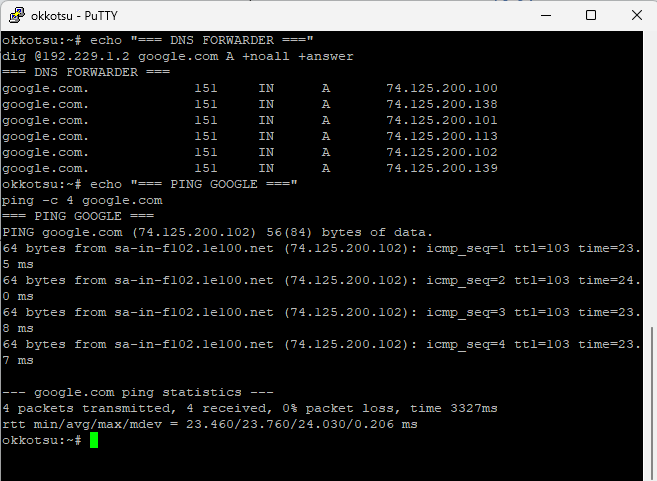

### Analisis dan kesimpulan

A record memetakan domain utama ke IP Gojo, CNAME menjadikan `www` alias dari domain utama, dan PTR memungkinkan pencarian balik dari IP Gojo ke nama domain. DNS forwarder meneruskan query eksternal ke `192.168.122.1`.

Soal dinyatakan berhasil apabila validasi forward dan reverse zone tidak menunjukkan error, ketiga query A/CNAME/PTR mengembalikan record yang diharapkan, serta query `google.com` melalui Utahime berhasil. Pengujian dari client harus dilakukan setelah konektivitas client ke DNS berfungsi. Cantumkan hasil aktual dan jangan menyatakan pengujian sukses apabila output belum sesuai expected.

## Soal 13 — MariaDB Master dan Slave

Kepala Sekolah Yaga dan Inumaki mendirikan database terpusat yang redundan agar log aktivitas kutukan tetap aman tersimpan. Konfigurasikan MariaDB pada **yaga** sebagai **DB-Master** dan **inumaki** sebagai **DB-Slave**. Buat database `db_shibuya_<xxxx>` beserta tabel `request_logs` di Master, aktifkan binary logging (`log-bin`, `server-id`), lalu hubungkan Inumaki sebagai Slave yang menyalin data secara realtime dengan `CHANGE MASTER TO`. Berikan hak akses remote bagi seluruh node di Network 4, lalu buktikan replikasi berhasil dengan memasukkan data baru di Master dan memeriksa hasilnya di Slave.

### Tujuan

- Menyiapkan Yaga sebagai MariaDB Master dan Inumaki sebagai MariaDB Slave.
- Membuat database `db_shibuya_K36` dan tabel `request_logs`.
- Mengaktifkan binary logging dan menetapkan `server-id` yang unik.
- Memberikan hak remote untuk node Network 4 dan hak replikasi bagi Inumaki.
- Membuktikan replikasi melalui status Slave dan pengujian data baru.

### Informasi Node

| Komponen             | Nilai            |
| -------------------- | ---------------- |
| Kelompok             | K-36             |
| Yaga (Master)        | `192.229.4.17`   |
| Inumaki (Slave)      | `192.229.4.18`   |
| Database             | `db_shibuya_K36` |
| Tabel                | `request_logs`   |
| Master `server-id`   | `1`              |
| Slave `server-id`    | `2`              |
| User replikasi       | `repl`           |
| User aplikasi remote | `k36user`        |

### Langkah Pengerjaan

#### A. Konfigurasi Master — Yaga

Simpan script `soal-13.sh` di `/root` pada node Yaga, lalu jalankan:

```bash
chmod +x /root/soal-13.sh
/root/soal-13.sh
```

Script memasang MariaDB jika belum ada, menyiapkan konfigurasi `bind-address = 0.0.0.0`, `server-id = 1`, `log_bin`, dan `binlog_format = ROW`. Script juga membuat database `db_shibuya_K36`, tabel `request_logs`, user replikasi `repl`, dan user remote `k36user` yang dibatasi untuk host Network 4 (`192.229.4.%`).

Validasi di Yaga:

```bash
mysql -e "SHOW GLOBAL VARIABLES WHERE Variable_name IN ('server_id','log_bin','bind_address','binlog_format');"
mysql -e "SHOW MASTER STATUS\\G"
mysql -e "SHOW DATABASES LIKE 'db_shibuya_K36'; USE db_shibuya_K36; DESCRIBE request_logs;"
mysql -e "SELECT User, Host FROM mysql.user WHERE User IN ('repl','k36user');"
```

**Expected:** `server_id` bernilai `1`, `log_bin` bernilai `ON`, `bind_address` bernilai `0.0.0.0`, `SHOW MASTER STATUS` menampilkan file dan posisi binary log, dan tabel `request_logs` tersedia.

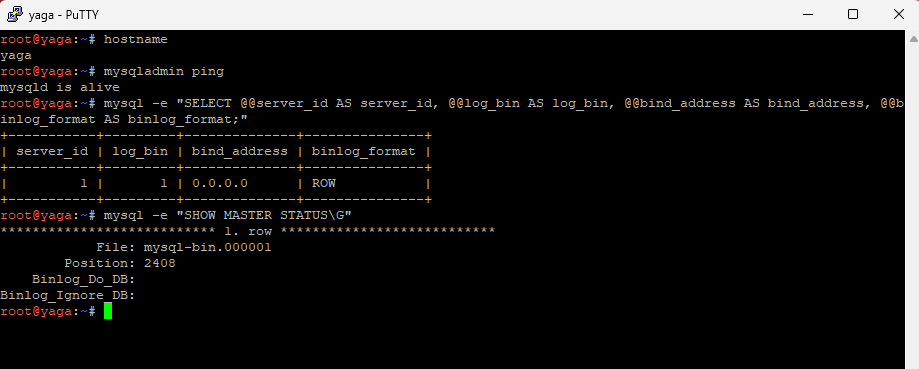 <br>
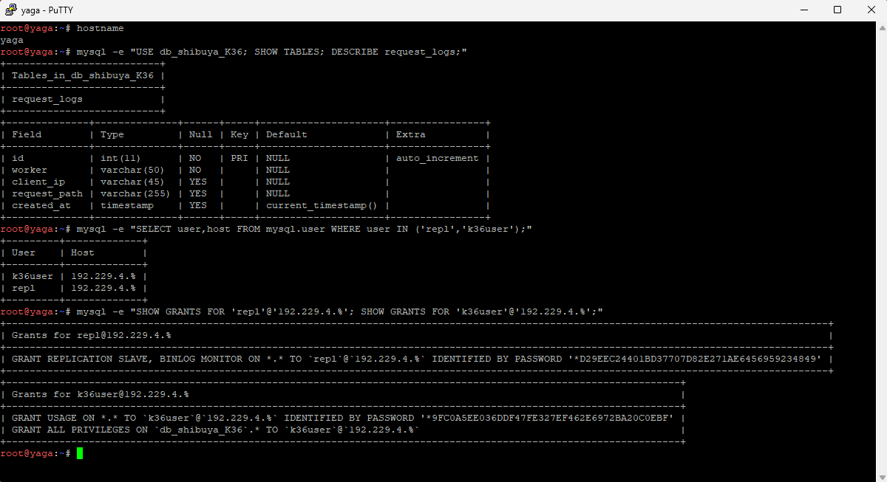

#### B. Konfigurasi Slave — Inumaki

Jalankan script Yaga sampai selesai terlebih dahulu. Setelah itu, simpan `soal-13.sh` di `/root` pada node Inumaki, lalu jalankan:

```bash
chmod +x /root/soal-13.sh
/root/soal-13.sh
```

Script memasang MariaDB jika diperlukan, menetapkan `server-id = 2`, mengaktifkan `relay_log`, mengatur `read_only = 1`, membuat schema dan tabel lokal yang sesuai, mengambil posisi binary log dari Master, lalu mengatur replikasi menggunakan `CHANGE MASTER TO` dengan `MASTER_LOG_FILE` dan `MASTER_LOG_POS`.

Validasi status replikasi di Inumaki:

```bash
mysql -e "SHOW SLAVE STATUS\\G" | grep -E 'Master_Host:|Master_User:|Master_Log_File:|Read_Master_Log_Pos:|Slave_IO_Running:|Slave_SQL_Running:|Seconds_Behind_Master:|Last_IO_Error:|Last_SQL_Error:'
```

**Expected:** `Master_Host` adalah `192.229.4.17`, `Slave_IO_Running: Yes`, `Slave_SQL_Running: Yes`, dan tidak ada pesan error pada `Last_IO_Error` maupun `Last_SQL_Error`. `Seconds_Behind_Master` umumnya `0` atau mendekati `0` saat tidak ada antrean.

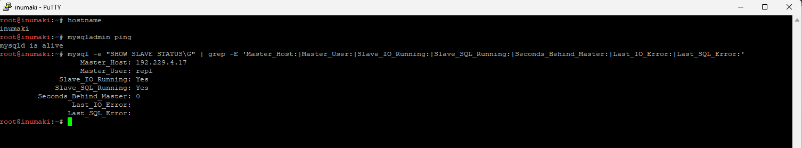

#### C. Uji replikasi data

Lakukan pengujian dari Inumaki. Perintah pertama mengirim `INSERT` melalui koneksi remote ke Yaga menggunakan user aplikasi, kemudian perintah kedua memeriksa apakah baris yang sama sudah muncul pada database lokal Inumaki.

```bash
MYSQL_PWD='K36_pass' mysql --protocol=tcp -h 192.229.4.17 -uk36user db_shibuya_K36 -e "INSERT INTO request_logs(worker,client_ip,request_path) VALUES ('soal13-test','192.229.4.18','/soal13-replication-test'); SELECT id,worker,client_ip,request_path,created_at FROM request_logs WHERE request_path='/soal13-replication-test' ORDER BY id DESC LIMIT 1;"

sleep 2
mysql -e "SELECT id,worker,client_ip,request_path,created_at FROM db_shibuya_K36.request_logs WHERE request_path='/soal13-replication-test' ORDER BY id DESC LIMIT 5;"
```

**Expected:** perintah pertama menampilkan baris yang baru dimasukkan ke Master. Setelah replikasi diproses, query lokal pada Inumaki menampilkan baris dengan `worker = soal13-test` dan `request_path = /soal13-replication-test`.

Jika baris belum muncul, jalankan `SHOW SLAVE STATUS\\G` dan periksa `Last_IO_Error` serta `Last_SQL_Error`; jangan menyimpulkan replikasi berhasil sebelum data tampak pada Slave.

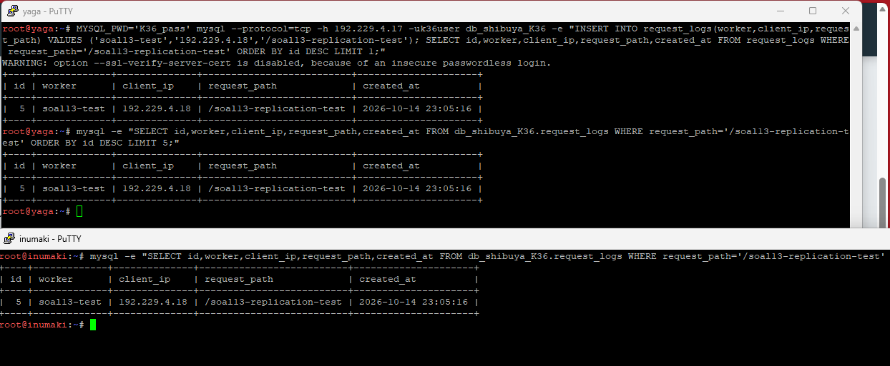

### Analisis

Yaga bertindak sebagai sumber utama data. Binary logging merekam perubahan yang terjadi pada Master, sedangkan Inumaki menggunakan konfigurasi replikasi untuk membaca dan menerapkan perubahan tersebut. `server-id` dibuat berbeda (`1` pada Yaga dan `2` pada Inumaki) agar kedua server dapat dibedakan dalam topologi replikasi.

User `repl` diberi hak replikasi dari Network 4, sedangkan `k36user` diberi akses ke database `db_shibuya_K36` dari alamat dalam subnet `192.229.4.0/24`. Replikasi dinyatakan berhasil jika kedua thread Slave berstatus `Yes` dan data uji yang dimasukkan melalui Master akhirnya dapat dibaca di Slave.

Script menggunakan posisi file dan posisi binary log dari `SHOW MASTER STATUS` pada `CHANGE MASTER TO`. Karena posisi diambil setelah schema awal disiapkan, script juga memastikan database dan tabel yang sama tersedia pada Inumaki sebelum replikasi dimulai.

### Kesimpulan

MariaDB pada Yaga dikonfigurasi sebagai Master dengan binary logging, database `db_shibuya_K36`, dan tabel `request_logs`. Inumaki dikonfigurasi sebagai Slave dengan `server-id` yang berbeda dan relay log. Keberhasilan dibuktikan melalui status replikasi `Slave_IO_Running: Yes` dan `Slave_SQL_Running: Yes`, serta data uji yang dimasukkan pada Master dan muncul pada Slave.

## Soal 14 — Frontend dan API Worker dengan Nginx, PHP-FPM, dan MariaDB

Para penyihir lapangan bersiaga di Data Center sebagai pekerja backend untuk memproses aplikasi. Pasang Nginx dan PHP-FPM pada **maki** dan **panda** untuk menyajikan web frontend yang menampilkan hostname masing-masing. Pada **nanami**, **todo**, dan **kirara**, siapkan layanan API yang mencatat log request ke database **yaga**. Konfigurasikan virtual host agar worker merespons domain layanan yang ditentukan. Batasi akses langsung dari klien ke worker, web worker hanya menerima trafik melalui jalur proxy web yang ditentukan, sedangkan worker API hanya menerima trafik melalui **geto**. Uji bahwa akses langsung dari klien ditolak, sementara akses melalui reverse proxy tetap berhasil.

### Tujuan

- Memasang Nginx dan PHP-FPM pada Maki serta Panda untuk frontend yang menampilkan hostname worker.
- Membuat API di Nanami, Todo, dan Kirara yang mencatat request ke `yaga`.
- Menyediakan virtual host untuk `jujutsu.k-36.com` dan `www.jujutsu.k-36.com`.
- Membatasi frontend agar hanya menerima trafik dari Gojo (`192.229.1.4`) dan API dari Geto (`192.229.4.11`), dengan localhost diizinkan untuk self-test.
- Membuktikan akses langsung dari client ditolak dan jalur melalui proxy berhasil.

### Node dan konfigurasi

| Node                 | Fungsi          | Nilai penting                                                   |
| -------------------- | --------------- | --------------------------------------------------------------- |
| Maki, Panda          | Frontend worker | Allowed proxy: Gojo `192.229.1.4`                               |
| Nanami, Todo, Kirara | API worker      | Allowed proxy: Geto `192.229.4.11`                              |
| Yaga                 | MariaDB         | `192.229.4.17`, database `db_shibuya_K36`, tabel `request_logs` |
| Virtual host         | Domain layanan  | `jujutsu.k-36.com`, `www.jujutsu.k-36.com`                      |

### Prasyarat

1. Soal 13 di Yaga telah berhasil dan `db_shibuya_K36.request_logs` tersedia.
2. User remote `k36user` dapat mengakses database dari worker Network 4.
3. IP Gojo `192.229.1.4`, Geto `192.229.4.11`, dan Yaga `192.229.4.17` sesuai alokasi kelompok.
4. Routing antarjaringan aktif dan setiap worker memiliki alamat IPv4 yang benar.
5. Gojo/Geto akan menjadi proxy yang diizinkan oleh ACL. Pengujian end-to-end melalui proxy dilakukan setelah konfigurasi Soal 15–16 tersedia.

### Script per node

| Node     | File script         |
| -------- | ------------------- |
| `maki`   | `soal-14-maki.sh`   |
| `panda`  | `soal-14-panda.sh`  |
| `nanami` | `soal-14-nanami.sh` |
| `todo`   | `soal-14-todo.sh`   |
| `kirara` | `soal-14-kirara.sh` |

Untuk setiap node, salin isi file script yang sesuai ke `/root`. Contoh pada Maki:

```bash
nano /root/soal-14-maki.sh
chmod +x /root/soal-14-maki.sh
/root/soal-14-maki.sh
```

### Penjelasan script

#### A. Maki dan Panda — frontend

Script melakukan pemeriksaan root/hostname, membuat backup konfigurasi yang ada, memasang Nginx, PHP-FPM, dan `curl`, lalu membuat `/var/www/frontend/index.php`. Halaman PHP menampilkan hostname sistem menggunakan `gethostname()`.

Virtual host menggunakan domain `jujutsu.k-36.com` dan `www.jujutsu.k-36.com`. Aturan Nginx `allow 127.0.0.1`, `allow 192.229.1.4`, dan `deny all` memungkinkan self-test localhost dan trafik dari Gojo, sekaligus menolak sumber lain.

Script kemudian memulai PHP-FPM, menjalankan `nginx -t`, memulai atau me-reload Nginx, dan melakukan self-test melalui localhost. Expected: HTTP 200 dan isi halaman menampilkan `maki` atau `panda` sesuai node.

#### B. Nanami, Todo, dan Kirara — API

Script memasang Nginx, PHP-FPM, `php-mysql`, `curl`, dan `mariadb-client`; lalu membuat `/var/www/api/api.php`. Endpoint `/api` membaca hostname worker, alamat sumber yang terlihat oleh worker, dan path request. Endpoint kemudian memasukkan data ke tabel `request_logs` pada Yaga melalui database `db_shibuya_K36` dan user `k36user`.

Virtual host mengizinkan localhost untuk self-test dan Geto (`192.229.4.11`) untuk trafik API, sedangkan sumber lain ditolak dengan `deny all`. Script memvalidasi sintaks PHP dan konfigurasi Nginx, memeriksa koneksi DB, lalu meminta endpoint lokal `/api`.

Expected saat seluruh dependency tersedia: HTTP 200 dan JSON dengan `status: ok`, hostname worker yang benar, dan `logged: true`. Jika DB tidak dapat dijangkau, API akan melaporkan error dan HTTP 500; periksa Soal 13, grant remote, routing, dan log. Pada Soal 14, `client_ip` mencatat IP sumber yang terlihat worker (biasanya Geto ketika melalui Geto). Penerusan IP asli dikerjakan pada Soal 17.

### Cara cek setiap node

#### Maki

```bash
hostname
ip -4 -br addr
nginx -t
pgrep -a nginx
pgrep -af 'php-fpm: master process'
curl -i -H 'Host: jujutsu.k-36.com' http://127.0.0.1/
```

Expected: `nginx -t` menampilkan `syntax is ok` dan `test is successful`; self-test memberi HTTP `200 OK` dan HTML menampilkan hostname `maki`.

#### Panda

```bash
hostname
ip -4 -br addr
nginx -t
curl -i -H 'Host: jujutsu.k-36.com' http://127.0.0.1/
```

Expected: HTTP `200 OK` dan HTML menampilkan hostname `panda`.

#### Nanami

```bash
hostname
ip -4 -br addr
nginx -t
php -l /var/www/api/api.php
MYSQL_PWD='K36_pass' mysql --connect-timeout=3 -h 192.229.4.17 -u k36user db_shibuya_K36 -e 'SELECT 1 AS db_connection;'
curl -i -H 'Host: jujutsu.k-36.com' http://127.0.0.1/api
```

Expected: PHP menyatakan `No syntax errors detected`, query DB mengembalikan `1`, dan API mengembalikan HTTP 200 dengan JSON `status: ok`, `worker: nanami`, `logged: true`.

#### Todo dan Kirara

Jalankan pada node masing-masing:

```bash
hostname
ip -4 -br addr
nginx -t
php -l /var/www/api/api.php
MYSQL_PWD='K36_pass' mysql --connect-timeout=3 -h 192.229.4.17 -u k36user db_shibuya_K36 -e 'SELECT 1 AS db_connection;'
curl -i -H 'Host: jujutsu.k-36.com' http://127.0.0.1/api
```

Expected JSON untuk Todo menampilkan `worker: todo`; untuk Kirara menampilkan `worker: kirara`. Keduanya diharapkan `status: ok` dan `logged: true` jika koneksi database berhasil.

### Uji pembatasan akses

#### A. Catat IP worker

Jalankan `ip -4 -br addr` pada node terkait. Ganti `<IP_MAKI>` dan `<IP_NANAMI>` berikut dengan IP aktual dari Master Sheet, tanpa tanda `< >`:

```bash
curl -i --max-time 5 -H 'Host: jujutsu.k-36.com' http://192.229.4.12/
curl -i --max-time 5 -H 'Host: jujutsu.k-36.com' http://192.229.4.14/api
```

Jalankan dari client yang memiliki routing menuju Network 4. Expected jika request mencapai Nginx: `HTTP/1.1 403 Forbidden`. Timeout atau `network unreachable` berarti konektivitas/routing belum benar dan **bukan** bukti ACL berhasil.

#### B. Uji jalur proxy yang diizinkan

Frontend mengizinkan Gojo (`192.229.1.4`); API mengizinkan Geto (`192.229.4.11`). Setelah routing antarjaringan aktif, uji dari node Gojo ke IP Maki/Panda dan dari node Geto ke IP Nanami/Todo/Kirara. Expected dari sumber proxy yang diizinkan: frontend HTTP 200, API HTTP 200 serta JSON sukses.

Pengujian end-to-end melalui domain publik dilakukan setelah Soal 15–16 (Geto load balancer dan Gojo reverse proxy) selesai. Dari client:

```bash
curl -i -H 'Host: jujutsu.k-36.com' http://192.229.1.4/
curl -i -H 'Host: jujutsu.k-36.com' http://192.229.1.4/api
```

Expected setelah konfigurasi proxy tersedia: `/` menampilkan halaman dari Maki/Panda dan `/api` menampilkan JSON dari worker API.

### Bukti request tersimpan di Yaga

Setelah endpoint API merespons sukses, pada Yaga jalankan:

```bash
mysql db_shibuya_K36 -e "SELECT id,worker,client_ip,request_path,created_at FROM request_logs ORDER BY id DESC LIMIT 10;"
```

Expected: baris request terbaru muncul di tabel `request_logs`, dengan nilai `worker` sesuai node API yang melayani request.

### Dokumentasi screenshot

#### Frontend Maki

Buktikan `nginx -t`, self-test localhost HTTP 200, dan hostname `maki`.

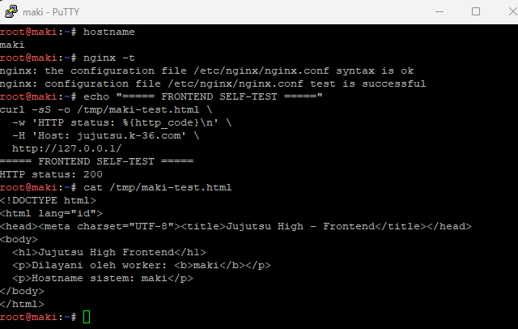

#### Frontend Panda

Buktikan self-test localhost HTTP 200 dan hostname `panda`.

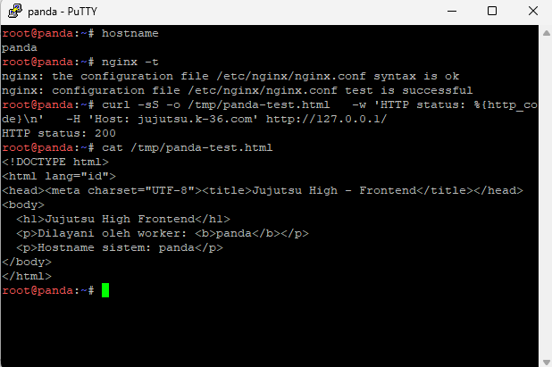

#### API workers

Ambil bukti self-test API pada Nanami, Todo, dan Kirara dengan JSON sukses serta `logged: true`. Bisa berupa tiga hasil terminal yang digabung dalam bagian yang sama.

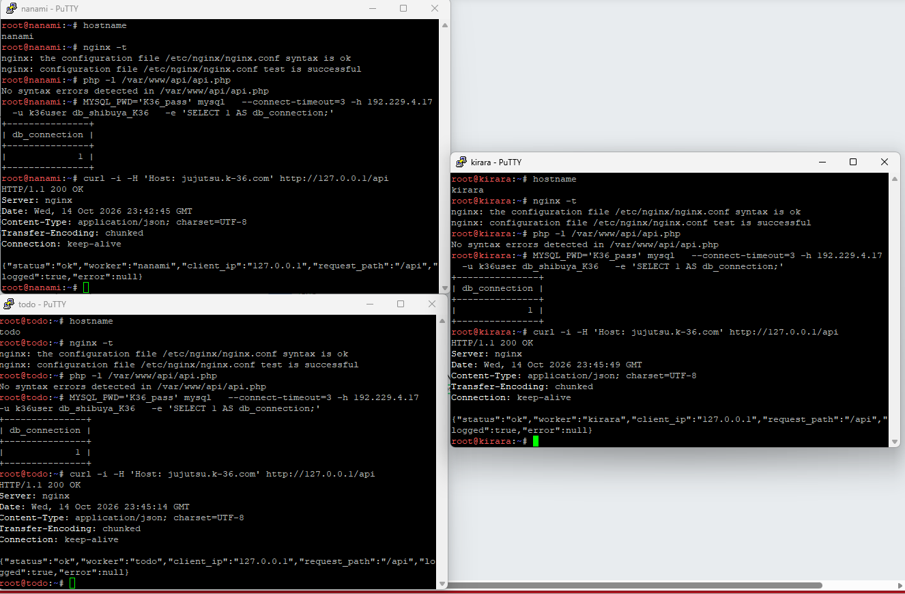

#### Request log di Yaga

Buktikan request dari endpoint API benar-benar tersimpan di tabel `request_logs`.

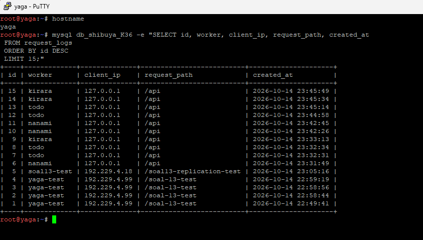

#### Akses langsung ditolak

Buktikan client yang tidak diizinkan mendapatkan HTTP 403 ketika mengakses langsung satu frontend worker dan satu API worker. Pastikan hasilnya bukan timeout atau network unreachable.

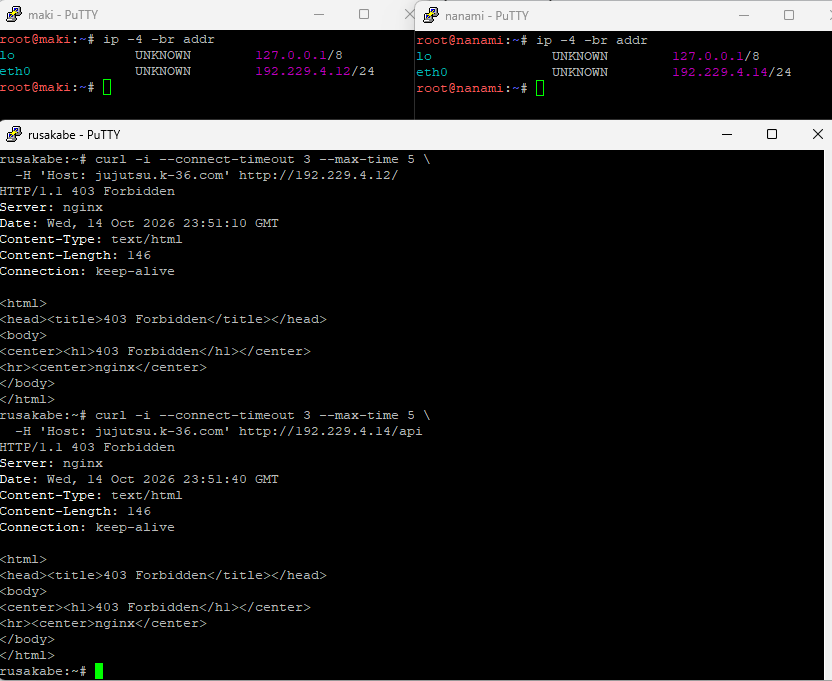

#### Akses melalui proxy

Ambil setelah konfigurasi Soal 15–16 selesai. Bukti harus menunjukkan `/` berhasil melalui Gojo dan `/api` berhasil melalui Geto/Gojo sesuai konfigurasi proxy.

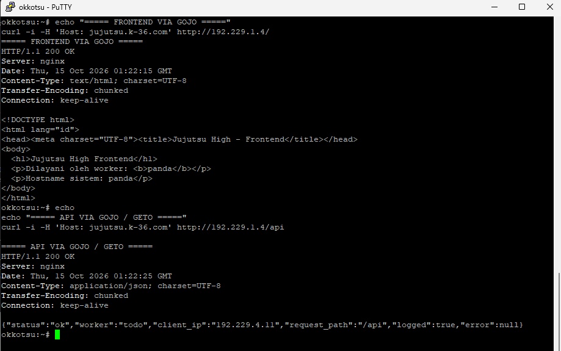

### Analisis

Maki dan Panda menyajikan halaman frontend yang menunjukkan hostname masing-masing. ACL Nginx mengizinkan sumber Gojo dan menolak client lain. Nanami, Todo, dan Kirara menyajikan endpoint `/api` dan mencatat worker, alamat sumber yang terlihat, serta path request ke database Yaga. ACL API mengizinkan Geto sebagai jalur masuk dan localhost untuk self-test.

Jika API menghasilkan HTTP 500 atau `logged: false`, endpoint sudah terpanggil tetapi pencatatan database gagal. Pemeriksaan harus difokuskan pada status Yaga, akses remote user `k36user`, routing worker ke Yaga, serta log API/Nginx.

HTTP 403 saat koneksi mencapai worker membuktikan ACL menolak sumber yang tidak diizinkan. Timeout dan `network unreachable` adalah masalah jaringan, bukan bukti penolakan ACL. Pengujian jalur proxy dilakukan setelah konfigurasi terkait pada Soal 15–16 siap.

### Kesimpulan

Maki dan Panda dikonfigurasi sebagai frontend worker menggunakan Nginx dan PHP-FPM, sedangkan Nanami, Todo, dan Kirara menyediakan API yang mencatat request ke `db_shibuya_K36.request_logs` pada Yaga. Virtual host menggunakan `jujutsu.k-36.com`, dengan ACL yang membatasi frontend hanya untuk Gojo dan API hanya untuk Geto (selain localhost untuk self-test). Keberhasilan akhir dibuktikan melalui self-test, pencatatan database, akses langsung yang ditolak, dan akses melalui proxy yang berhasil setelah konfigurasi proxy terkait tersedia.

## Soal 15 — Nginx Internal Load Balancer dengan Weighted Round Robin

Geto bertugas mengendalikan pembagian beban request API di internal Data Center agar server tidak tumbang bersamaan. Konfigurasikan **Nginx pada geto sebagai Load Balancer internal** dengan upstream `api_cluster` yang mengarahkan trafik ke **nanami** dan **todo**. Terapkan algoritma **Weighted Round Robin** dengan bobot **3:1**, di mana nanami menerima porsi beban tiga kali lebih banyak daripada todo. Buktikan distribusi beban ini dengan melakukan loop request berulang kali ke geto dari jaringan lokal Data Center dan periksa rasio responsnya.

### Tujuan

- Mengonfigurasi Nginx pada Geto sebagai internal load balancer.
- Mengarahkan request ke worker API Nanami dan Todo melalui upstream `api_cluster`.
- Menerapkan Weighted Round Robin dengan bobot Nanami:Todo sebesar 3:1.
- Menguji banyak request ke Geto dan menghitung worker yang melayani request.
- Memeriksa access log Geto untuk memastikan distribusi request benar-benar menuju kedua upstream.

### Informasi node

| Komponen               | Hostname | IP yang digunakan script |
| ---------------------- | -------- | ------------------------ |
| Internal load balancer | `geto`   | `192.229.4.11`           |
| API worker utama 1     | `nanami` | `192.229.4.14`           |
| API worker utama 2     | `todo`   | `192.229.4.15`           |
| Domain Host header     | —        | `jujutsu.k-36.com`       |

### Konfigurasi dan cara menjalankan

Simpan script di `/root/soal-15.sh` pada node **Geto**. Cara membuat file:

```bash
nano /root/soal-15.sh
```

Tempel isi script `soal-15.sh`, simpan dengan `Ctrl+O`, tekan `Enter`, lalu keluar menggunakan `Ctrl+X`. Setelah itu jalankan:

```bash
chmod +x /root/soal-15.sh
/root/soal-15.sh
```

Script memeriksa hostname dan IP Geto, memasang Nginx serta curl jika belum tersedia, membuat backup konfigurasi `api_lb` sebelumnya, menyiapkan upstream dan access log, memvalidasi konfigurasi dengan `nginx -t`, lalu menjalankan Nginx.

Konfigurasi inti upstream:

```nginx
upstream api_cluster {
    server 192.229.4.14:80 weight=3;
    server 192.229.4.15:80 weight=1;
}
```

- `192.229.4.14 weight=3` membuat Nanami menerima bobot tiga.
- `192.229.4.15 weight=1` membuat Todo menerima bobot satu.
- `proxy_pass http://api_cluster;` meneruskan request ke kumpulan worker tersebut.
- Nginx menggunakan Weighted Round Robin secara default jika metode balancing lain tidak ditentukan.
- Log `/var/log/nginx/geto_lb.log` menyimpan alamat upstream untuk setiap request.

Script juga melakukan self-test 40 request menuju `http://127.0.0.1/api`, lalu menghitung HTTP status dan nama worker pada JSON respons. Pastikan Nanami dan Todo sudah aktif serta endpoint API masing-masing sudah lolos pengujian Soal 14 sebelum menjalankan pengujian distribusi.

### Pemeriksaan konfigurasi

Di Geto, jalankan:

```bash
hostname
nginx -t
cat /etc/nginx/sites-available/api_lb
```

Expected:

- `hostname` menghasilkan `geto`.
- `nginx -t` menampilkan `syntax is ok` dan `test is successful`.
- Konfigurasi memperlihatkan upstream `api_cluster` dengan `weight=3` untuk Nanami dan `weight=1` untuk Todo.

Periksa juga proses Nginx:

```bash
pgrep -a nginx
```

### Pengujian distribusi beban

Jalankan dari Geto setelah konfigurasi aktif:

```bash
for i in $(seq 1 40); do
    curl -sS --connect-timeout 3 --max-time 8 \
      -H 'Host: jujutsu.k-36.com' http://127.0.0.1/api
    echo
done | grep -oE '"worker":"(nanami|todo)"' | sort | uniq -c
```

Expected output ideal untuk 40 request yang seluruhnya berhasil:

```text
     30 "worker":"nanami"
     10 "worker":"todo"
```

Ini merepresentasikan rasio 3:1 (sekitar 75% request ke Nanami dan 25% ke Todo). Catat hasil aktual. Jika angkanya berbeda, jangan langsung mengklaim distribusi sesuai; periksa apakah ada request gagal, respons API bukan JSON sukses, atau salah satu worker tidak tersedia.

Untuk melihat status HTTP dan respons worker secara jelas, jalankan:

```bash
for i in $(seq 1 10); do
    curl -sS -o /tmp/geto-api.out -w 'HTTP %{http_code}\n' \
      -H 'Host: jujutsu.k-36.com' http://127.0.0.1/api
    cat /tmp/geto-api.out
    echo
done
```

Expected: masing-masing request sukses dengan HTTP `200`, serta JSON menampilkan `"status":"ok"`, nama worker (`nanami` atau `todo`), dan `"logged":true` jika pencatatan ke database Yaga berhasil.

### Pemeriksaan access log

Setelah loop request, jalankan di Geto:

```bash
tail -n 20 /var/log/nginx/geto_lb.log
```

Expected: baris log menampilkan request `/api`, status HTTP, dan `upstream=192.229.4.14:80` atau `upstream=192.229.4.15:80`.

Hitung jumlah request pada log yang mengarah ke setiap worker:

```bash
grep -c 'upstream=192.229.4.14:80' /var/log/nginx/geto_lb.log
grep -c 'upstream=192.229.4.15:80' /var/log/nginx/geto_lb.log
```

Perintah `grep -c` menghitung semua baris yang cocok di file log, bukan hanya pengujian terakhir. Jika ingin menghitung percobaan tertentu saja, bersihkan atau salin log terlebih dahulu sebelum loop pengujian baru, atau gunakan file log terpisah untuk pengujian tersebut.

### Dokumentasi screenshot

#### Validasi dan konfigurasi upstream

Jalankan di Geto:

```bash
clear
hostname
nginx -t
grep -A5 -B1 'upstream api_cluster' /etc/nginx/sites-available/api_lb
```

Expected: hostname `geto`, validasi Nginx sukses, dan konfigurasi menampilkan Nanami `weight=3` serta Todo `weight=1`.

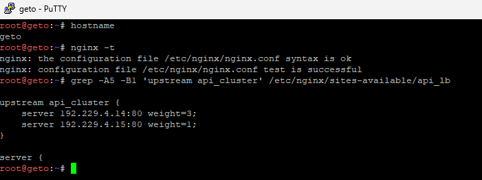

#### Distribusi 40 request

Jalankan loop 40 request pada Bagian 6. Pastikan output jumlah worker terlihat.

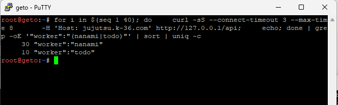

#### Access log Geto

Jalankan:

```bash
 tail -n 20 /var/log/nginx/geto_lb.log
```

Expected: log menunjukkan alamat upstream Nanami dan Todo, request `/api`, serta status HTTP.

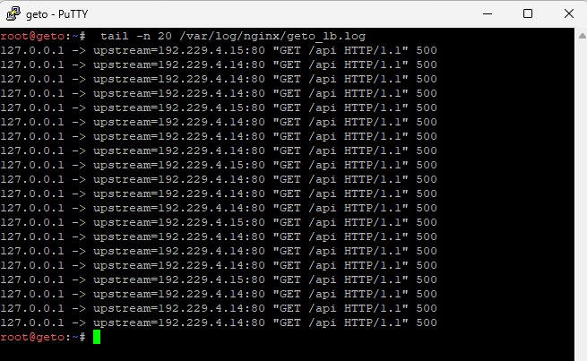

### Analisis hasil

Weighted Round Robin membagikan request berdasarkan bobot yang ditetapkan. Dengan bobot Nanami 3 dan Todo 1, proporsi teoritisnya adalah 3/4 atau 75% untuk Nanami dan 1/4 atau 25% untuk Todo. Untuk 40 request sukses, distribusi idealnya adalah 30 request ke Nanami dan 10 request ke Todo.

Respons JSON dari worker membuktikan node yang melayani tiap request, sedangkan access log Geto memperlihatkan alamat upstream yang dipilih Nginx. Kedua bukti tersebut perlu konsisten. Jika jumlah request sukses kurang dari 40 atau salah satu worker gagal, hasil aktual harus dilaporkan apa adanya dan kendalanya dianalisis.

### Kesimpulan

Nginx pada Geto dikonfigurasi sebagai internal load balancer menggunakan upstream `api_cluster`. Bobot Nanami dan Todo diatur 3:1 dengan metode Weighted Round Robin. Keberhasilan diuji melalui validasi Nginx, loop 40 request dari Geto, pemeriksaan JSON worker, dan access log upstream. Load balancing dapat dinyatakan sesuai rancangan apabila kedua worker menerima request dan distribusi aktual mendekati rasio bobot 3:1 tanpa kegagalan request yang tidak terjelaskan.

## Soal 16 — Public Reverse Proxy Gojo dengan Path-Based Routing

Gojo berdiri di perbatasan DMZ sebagai gerbang publik tunggal bagi seluruh client dari luar maupun dalam. Konfigurasikan **Nginx** pada **gojo** untuk melayani domain **jujutsu.<xxxx>.com** dan **www.jujutsu.<xxxx>.com** menggunakan metode **Path-Based Routing**. Atur agar request root (`/`) diteruskan secara Round Robin ke worker frontend (maki dan panda), sedangkan request ke path `/api` diteruskan langsung ke geto. Uji dari client Divisi A atau B bahwa akses ke web utama dibalas oleh Maki/Panda, sedangkan akses ke `/api` diteruskan dan dijawab oleh Nanami/Todo.

### Tujuan

- Mengonfigurasi Gojo sebagai public reverse proxy Nginx.
- Meneruskan request `/` secara Round Robin ke Maki dan Panda.
- Meneruskan request `/api` ke Geto sebagai internal load balancer.
- Membuktikan routing melalui pengujian client dan access log Gojo.

### IP dan domain

| Komponen | IP / nilai         |
| -------- | ------------------ |
| Domain   | `jujutsu.k-36.com` |
| Gojo     | `192.229.1.4`      |
| Maki     | `192.229.4.12`     |
| Panda    | `192.229.4.13`     |
| Geto     | `192.229.4.11`     |

### Script dan cara menjalankan

Script dijalankan **hanya di node `gojo`**. Simpan file yang disediakan sebagai `/root/soal-16.sh`:

```bash
nano /root/soal-16.sh
```

Salin isi file `soal-16.sh`, lalu simpan (`Ctrl+O`, `Enter`, `Ctrl+X`). Jalankan:

```bash
chmod +x /root/soal-16.sh
/root/soal-16.sh
```

Script memasang Nginx/curl jika belum tersedia, membuat upstream frontend dan Geto, memvalidasi Nginx dengan `nginx -t`, menyalakan atau me-reload Nginx, lalu menjalankan self-test.

### Penjelasan konfigurasi

- `upstream frontend_cluster` berisi Maki (`192.229.4.12`) dan Panda (`192.229.4.13`). Karena tidak diberi bobot khusus, Nginx menggunakan Round Robin secara default.
- `upstream geto_lb` mengarahkan request API ke Geto (`192.229.4.11`).
- `location ^~ /api` meneruskan request `/api` ke Geto.
- `location /` meneruskan request frontend ke `frontend_cluster`.
- `proxy_set_header Host $host` meneruskan hostname request ke backend.
- `gojo_access.log` mencatat request, status HTTP, serta upstream yang dipilih.

### Pengujian dan dokumentasi screenshot

#### Validasi konfigurasi Gojo

**Node:** `gojo`

```bash
clear
hostname
nginx -t
grep -nE 'server_name|upstream frontend_cluster|server 192\.229\.4\.(12|13|11)|location \^~ /api|location /|proxy_pass' /etc/nginx/sites-available/gojo
```

**Expected output:** hostname `gojo`; `nginx -t` menunjukkan `syntax is ok` dan `test is successful`; konfigurasi memperlihatkan upstream Maki/Panda, upstream Geto, dan dua aturan routing.
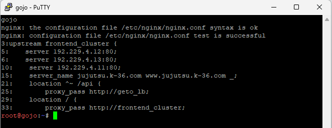

#### Pengujian routing dari client

**Node:** client Network 2 atau Network 3 yang sudah terhubung.

Jalankan beberapa request frontend untuk melihat Round Robin:

```bash
for i in 1 2 3 4; do
  echo "===== FRONTEND REQUEST $i ====="
  curl -sS --connect-timeout 3 --max-time 10 \
    -H 'Host: jujutsu.k-36.com' "http://192.229.1.4/?test=$i"
  echo
done
```

Kemudian uji API:

```bash
curl -i --connect-timeout 3 --max-time 15 \
  -H 'Host: jujutsu.k-36.com' http://192.229.1.4/api
```

**Expected output:** request `/` mengembalikan HTTP 200 dan HTML menyebut worker `maki` atau `panda`; request `/api` mengembalikan respons API sukses dengan HTTP 200 dan JSON menyebut worker API (misalnya `nanami` atau `todo`) serta `logged: true`. Jika muncul timeout, `network unreachable`, 403 yang tidak diharapkan, 500, atau 502, jangan menyatakan pengujian berhasil—periksa konektivitas, ACL worker, Geto, serta database.

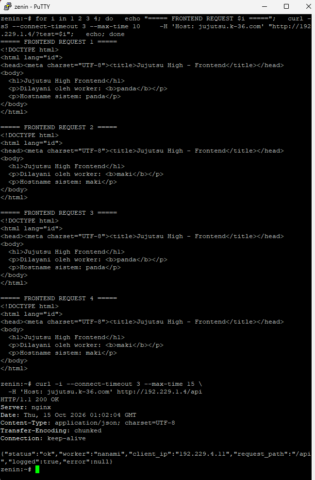

#### Verifikasi access log Gojo

**Node:** `gojo`

Setelah pengujian client dilakukan, jalankan:

```bash
tail -n 30 /var/log/nginx/gojo_access.log
```

**Expected output:** baris log menunjukkan path dan status request serta `ups=` dengan alamat upstream. Request frontend harus diarahkan ke Maki/Panda, sedangkan request `/api` diarahkan ke Geto (`192.229.4.11`).

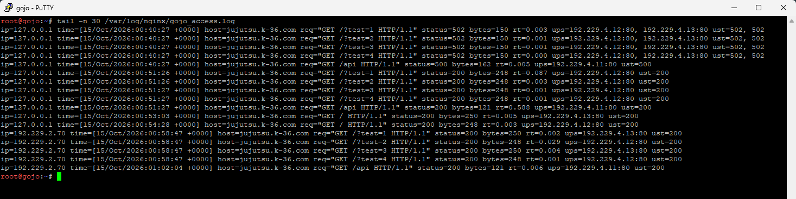

### Analisis dan kesimpulan

Gojo menggunakan Nginx sebagai public reverse proxy dengan Path-Based Routing. Request ke `/` diteruskan ke Maki dan Panda menggunakan Round Robin, sedangkan request `/api` diteruskan ke Geto untuk diproses oleh worker API. Hasil pengujian client dan access log digunakan untuk memeriksa jalur request yang aktual. Kesimpulan bahwa konfigurasi berhasil hanya dibuat jika hasil nyata sesuai expected output.

## Soal 17 — Meneruskan dan Memverifikasi IP Client

Komando pusat perlu mengetahui IP asli klien yang mengirimkan request tanpa tertukar dengan IP proxy perantara. Konfigurasikan **gojo** dan **geto** agar meneruskan informasi alamat klien melalui header **`X-Real-IP`** dan **`X-Forwarded-For`**. Pastikan **geto hanya mempercayai informasi alamat klien yang diterima dari proxy terpercaya**, dan skrip API menyimpan alamat klien yang telah diverifikasi ke kolom **`client_ip`** pada tabel **`request_logs`** di database **yaga**. Uji dengan mengirimkan request dari klien Network 2 dan Network 3 ke endpoint **`/api`**, kemudian periksa database untuk memastikan alamat yang tercatat sesuai dengan IP klien asal, bukan IP **gojo** atau **geto**.

### Tujuan

- Meneruskan IP asli client dari Gojo ke Geto menggunakan `X-Real-IP` dan `X-Forwarded-For`.
- Membatasi kepercayaan terhadap header IP agar hanya informasi dari Gojo (proxy tepercaya) yang digunakan.
- Menyimpan IP client yang sudah diverifikasi ke `request_logs.client_ip` di database Yaga.
- Membuktikan IP yang tercatat benar dari client Network 2 dan Network 3.

### Topologi dan IP yang digunakan

| Node             | IP               | Peran                                             |
| ---------------- | ---------------- | ------------------------------------------------- |
| Gojo             | `192.229.1.4`    | Public reverse proxy                              |
| Geto             | `192.229.4.11`   | Internal load balancer / proxy tepercaya bagi API |
| Nanami           | `192.229.4.14`   | API worker                                        |
| Todo             | `192.229.4.15`   | API worker                                        |
| Kirara           | `192.229.4.18`\* | API worker cadangan/kompatibel                    |
| Yaga             | `192.229.4.17`   | MariaDB Master                                    |
| Client Network 2 | `192.229.2.x`    | Penguji API                                       |
| Client Network 3 | `192.229.3.x`    | Penguji API                                       |

### Urutan konfigurasi

Pastikan Soal 13 (database Yaga) dan Soal 14 (API workers) sudah berfungsi. Jalankan script berdasarkan hostname dan urutan berikut:

1. `soal-17-nanami.sh` di node **nanami**.
2. `soal-17-todo.sh` di node **todo**.
3. `soal-17-kirara.sh` di node **kirara**.
4. `soal-17-geto.sh` di node **geto**.
5. `soal-17-gojo.sh` di node **gojo**.

Pada node tujuan, simpan script yang sesuai di `/root`, misalnya:

```bash
nano /root/soal-17-nanami.sh
chmod +x /root/soal-17-nanami.sh
/root/soal-17-nanami.sh
```

### Penjelasan konfigurasi

#### 1. Gojo — meneruskan IP client

File: `/etc/nginx/sites-available/gojo`.

Pada request ke `/` dan `/api`, Gojo mengatur header:

```nginx
proxy_set_header X-Real-IP $remote_addr;
proxy_set_header X-Forwarded-For $proxy_add_x_forwarded_for;
```

Nilai `$remote_addr` adalah alamat peer yang benar-benar terhubung ke Gojo. Gojo menulis ulang `X-Real-IP` dengan `$remote_addr` agar client tidak dapat memalsukan nilai yang dipakai untuk verifikasi. `X-Forwarded-For` memakai `$proxy_add_x_forwarded_for` untuk meneruskan rantai header; Geto tetap menggunakan hanya `X-Real-IP` dari peer tepercaya sebagai nilai yang akan disimpan di database. Request `/` diteruskan ke `maki`/`panda`, sedangkan `/api` diteruskan ke Geto.

#### 2. Geto — memercayai hanya Gojo

File: `/etc/nginx/sites-available/api_lb`.

`geo` menandai peer `192.229.1.4/32` sebagai proxy tepercaya. `map` memilih nilai `X-Real-IP` hanya ketika koneksi aktual berasal dari Gojo; untuk peer lain, nilai yang digunakan adalah `$remote_addr`. Geto kemudian mengirim IP yang telah diverifikasi ke API worker.

#### 3. API worker — validasi ulang sebelum insert

File: `/var/www/api/api.php` pada Nanami, Todo, dan Kirara. Script PHP hanya memakai `HTTP_X_REAL_IP` jika `REMOTE_ADDR` (peer koneksi) adalah `192.229.4.11` (Geto) dan header berisi alamat IP yang valid. Selain itu, IP yang digunakan adalah alamat peer. Data yang disimpan mencakup worker, IP client, dan path request.

### Validasi konfigurasi

#### Gojo

```bash
hostname
nginx -t
grep -nE 'server_name|X-Real-IP|X-Forwarded-For|proxy_pass' /etc/nginx/sites-available/gojo
```

Expected: hostname `gojo`; `nginx -t` menyatakan syntax OK dan test successful; konfigurasi berisi kedua header dan rute ke `geto_lb` serta `frontend_cluster`.

#### Geto

```bash
hostname
nginx -t
grep -nE 'geo|map|192\.229\.1\.4|verified_client_ip|X-Real-IP|X-Forwarded-For|weight=' /etc/nginx/sites-available/api_lb
```

Expected: syntax OK; IP Gojo `192.229.1.4/32` adalah proxy tepercaya; upstream Nanami dan Todo memakai bobot 3:1; Geto mengirim IP yang telah diverifikasi ke backend.

#### API worker

Pada masing-masing Nanami, Todo, dan Kirara:

```bash
hostname
nginx -t
php -l /var/www/api/api.php
curl -i -H 'Host: jujutsu.k-36.com' http://127.0.0.1/api
```

Expected: Nginx valid, PHP tidak memiliki syntax error, dan self-test localhost menghasilkan JSON. Pada self-test localhost, `client_ip` umumnya `127.0.0.1` karena request tidak datang melalui Geto. Jika database berjalan dan user bisa mengakses tabel, hasilnya memuat `"status":"ok"` dan `"logged":true`.

### Pengujian end-to-end dari Network 2 dan Network 3

Lakukan setelah layanan Gojo, Geto, API workers, dan Yaga berjalan serta jaringan client aktif.

#### Client Network 2

Di satu client Network 2, misalnya Zenin :

```bash
hostname
ip -4 -br addr
curl -i -H 'Host: jujutsu.k-36.com' http://192.229.1.4/api
```

Expected: HTTP 200 dan JSON berisi `status: ok`, `logged: true`, `client_ip` sama dengan IPv4 client Network 2, serta `proxy_ip` menunjukkan `192.229.4.11` (Geto).

#### Client Network 3

Di satu client Network 3, misalnya Ino atau Kusakabe:

```bash
hostname
ip -4 -br addr
curl -i -H 'Host: jujutsu.k-36.com' http://192.229.1.4/api
```

Expected: HTTP 200 dan JSON berisi IP aktual client Network 3 pada `client_ip`; `proxy_ip` menunjukkan Geto. Pastikan client sudah memiliki IP dan gateway sebelum pengujian.

### Verifikasi database di Yaga

Di node **yaga**, jalankan:

```bash
mysql db_shibuya_K36 -e "SELECT id, worker, client_ip, request_path, created_at FROM request_logs WHERE request_path='/api' ORDER BY id DESC LIMIT 20;"
```

Expected: record terbaru memperlihatkan IP client Network 2 dan Network 3 pada kolom `client_ip`. Alamat tersebut tidak boleh hanya berupa IP Gojo (`192.229.1.4`) atau Geto (`192.229.4.11`). Untuk menyimpulkan benar, cocokkan setiap baris dengan IP aktual client yang melakukan request.

Opsional, uji perlindungan terhadap header palsu dari client:

```bash
curl -i -H 'Host: jujutsu.k-36.com' -H 'X-Real-IP: 203.0.113.77' http://192.229.1.4/api
```

Expected: jika request mencapai API, `client_ip` harus tetap IP aktual client, bukan `203.0.113.77`, karena Gojo menulis ulang header `X-Real-IP` berdasarkan koneksi yang sebenarnya.

### Dokumentasi screenshot

#### Header IP di Gojo

Ambil di Gojo:

```bash
nginx -t
grep -nE 'X-Real-IP|X-Forwarded-For|proxy_pass' /etc/nginx/sites-available/gojo
```

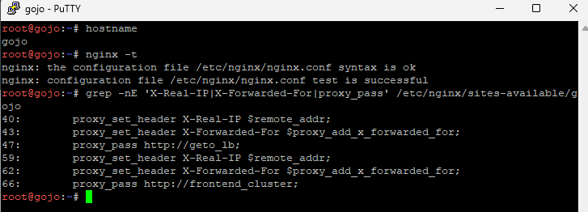

Keterangan: konfigurasi Gojo menulis header alamat client ketika meneruskan request ke frontend dan Geto.

#### Proxy tepercaya di Geto

Ambil di Geto:

```bash
nginx -t
grep -nE 'geo|map|192\.229\.1\.4|verified_client_ip|X-Real-IP|X-Forwarded-For' /etc/nginx/sites-available/api_lb
```

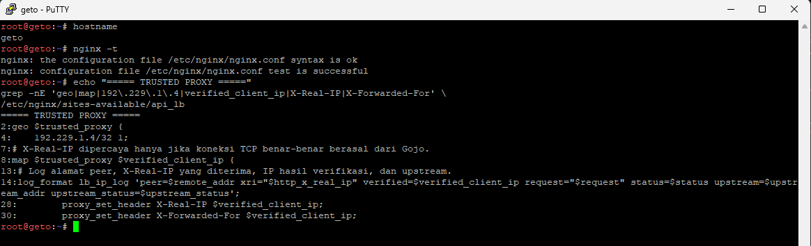

Keterangan: Geto mempercayai nilai `X-Real-IP` hanya dari peer Gojo dan meneruskan alamat yang telah diverifikasi ke API worker.

#### Request API dari Network 2 dan 3

Ambil bukti output `curl` sukses dari masing-masing client. Tampilkan hostname/IP client serta field `client_ip`, `proxy_ip`, dan `logged` pada JSON.

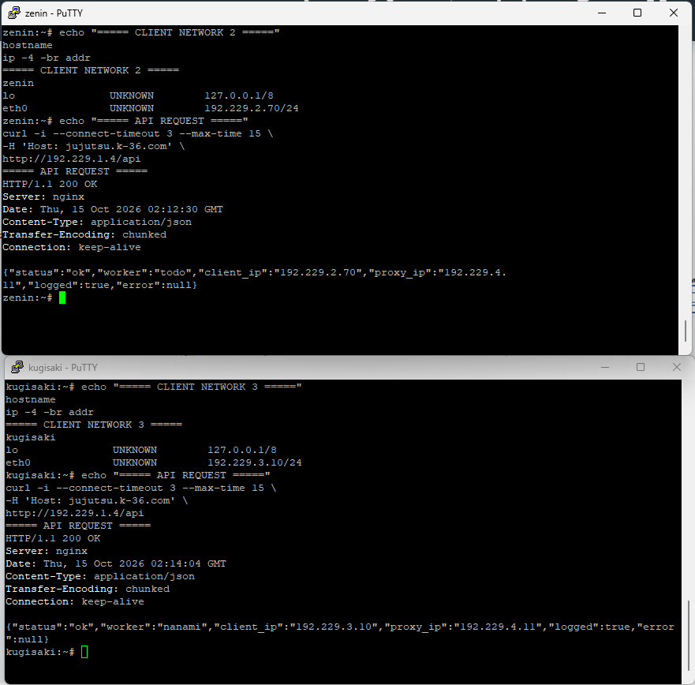

Keterangan: request API dikirim melalui Gojo dari client Network 2 dan Network 3. JSON menunjukkan alamat client yang diverifikasi dan alamat peer proxy Geto.

#### Bukti database

Ambil di Yaga menggunakan query pada bagian 8.

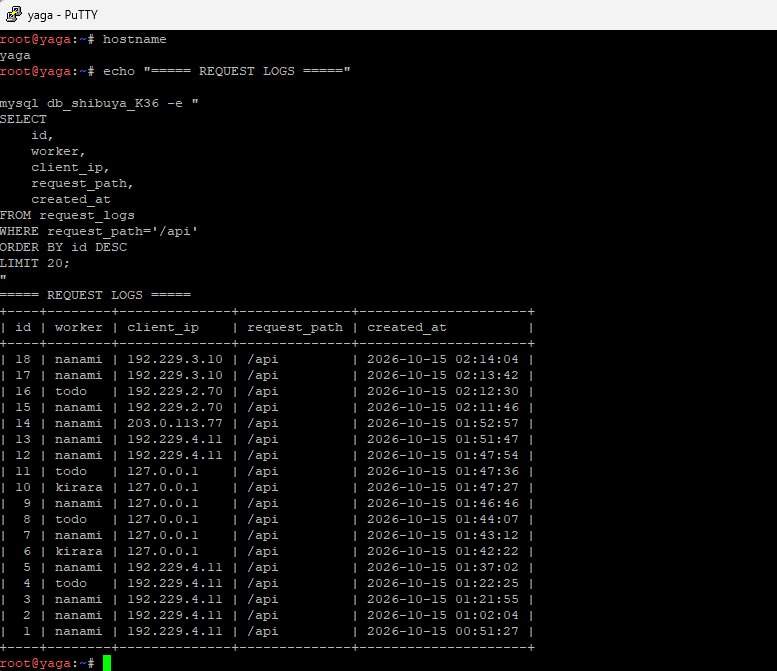

Keterangan: tabel `request_logs` menunjukkan IP client yang disimpan untuk request `/api`, sehingga hasilnya dapat dibandingkan dengan IP aktual client Network 2 dan Network 3.

### Kesimpulan

Soal 17 berhasil apabila Gojo meneruskan header IP ke Geto, Geto hanya menggunakan `X-Real-IP` dari proxy tepercaya, dan API worker menyimpan IP yang telah diverifikasi ke `request_logs.client_ip` di Yaga. Keberhasilan harus dibuktikan dengan request nyata dari Network 2 dan Network 3 serta kecocokan IP pada respons API dan database.

## Soal 18 — Health Check dan Backup API

**nanami** dan **todo** merupakan worker API utama, sedangkan **kirara** disiapkan sebagai worker cadangan. Konfigurasikan upstream **api_cluster** pada **geto** agar **kirara** menjadi server backup, serta terapkan passive health check dengan parameter **max_fails=2** dan **fail_timeout=5s** pada worker API utama. Pastikan **kirara** menjalankan layanan API yang kompatibel dengan endpoint utama. Simulasikan gangguan dengan menghentikan layanan Nginx atau layanan API pada **nanami** dan **todo**. Buktikan dari klien bahwa request ke **/api** dialihkan ke **kirara** dan menghasilkan respons API yang valid tanpa error **502 Bad Gateway.**

### Tujuan

Pada Soal 18, konfigurasi Load Balancer Geto dikembangkan dengan mekanisme passive health check. Worker Nanami dan Todo tetap menjadi server utama dengan bobot `3:1`, sedangkan Kirara digunakan sebagai server `backup`.

Jika worker utama mengalami kegagalan, Nginx akan mencoba upstream berikutnya. Apabila seluruh worker utama tidak tersedia, request akan diteruskan ke Kirara sebagai backup.

**Domain:** `jujutsu.k-36.com`

#### 1. Konfigurasi Health Check dan Backup pada Geto

Konfigurasi pada Geto menggunakan:

- Nanami: `192.229.4.14`, weight `3`
- Todo: `192.229.4.15`, weight `1`
- Kirara: `192.229.4.16`, sebagai `backup`
- `max_fails=2`
- `fail_timeout=5s`
- `proxy_next_upstream` untuk mencoba upstream berikutnya.

Validasi dilakukan dengan:

```bash
nginx -t

grep -nE 'upstream|192\.229\.4\.14|192\.229\.4\.15|192\.229\.4\.16|max_fails|fail_timeout|backup|proxy_next_upstream' \
/etc/nginx/sites-available/api_lb
```

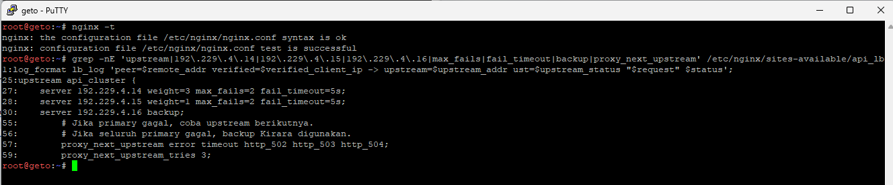

**Keterangan:**  
Screenshot menunjukkan konfigurasi Load Balancer Geto berhasil divalidasi. Nanami dan Todo digunakan sebagai upstream utama dengan passive health check, sedangkan Kirara dikonfigurasi sebagai server `backup`.

#### 2. Pengujian Failover Nanami ke Todo

Nginx pada Nanami dihentikan untuk mensimulasikan kegagalan worker:

```bash
service nginx stop
```

Kemudian request API dikirim berulang kali dari Geto:

```bash
for i in $(seq 1 10); do
    echo -n "Request $i: "
    curl -sS --connect-timeout 3 --max-time 5 \
      -H 'Host: jujutsu.k-36.com' \
      http://127.0.0.1/api
    echo
done
```

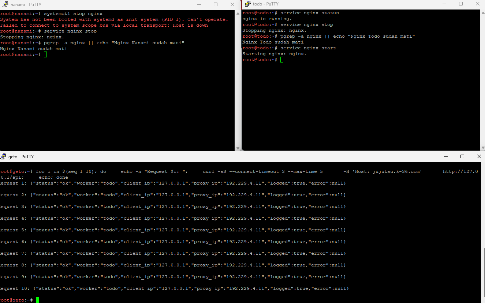

**Keterangan:**  
Screenshot menunjukkan bahwa setelah Nanami tidak tersedia, Geto melakukan failover dan request API tetap dapat dilayani oleh worker Todo.

#### 3. Pengujian Kirara sebagai Backup

Setelah pengujian sebelumnya, Nginx pada Todo juga dihentikan:

```bash
service nginx stop
```

Dengan kondisi Nanami dan Todo tidak tersedia, request kembali dikirim dari Geto:

```bash
for i in $(seq 1 5); do
    echo -n "Request $i: "
    curl -sS --connect-timeout 3 --max-time 5 \
      -H 'Host: jujutsu.k-36.com' \
      http://127.0.0.1/api
    echo
done
```

Output diharapkan menunjukkan:

```text
"worker":"kirara"
```

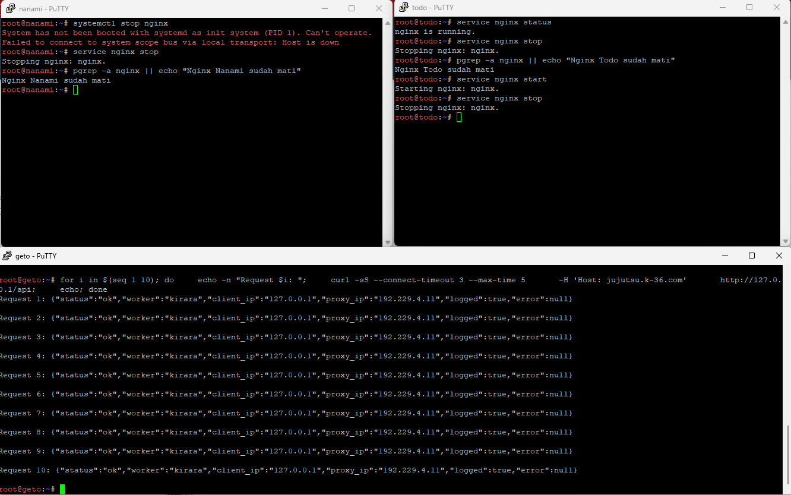

**Keterangan:**  
Screenshot menunjukkan bahwa ketika Nanami dan Todo tidak tersedia, Geto berhasil meneruskan request ke Kirara sebagai server `backup`. Dengan demikian layanan API tetap tersedia meskipun seluruh worker utama mengalami kegagalan.

### Kesimpulan

Konfigurasi Soal 18 berhasil menerapkan passive health check pada Load Balancer Geto. Nanami dan Todo digunakan sebagai worker utama dengan bobot `3:1`, sedangkan Kirara berfungsi sebagai backup. Pengujian menunjukkan bahwa request dapat berpindah dari worker yang gagal ke worker utama lainnya dan akhirnya menggunakan Kirara apabila seluruh worker utama tidak tersedia.

### Pemulihan Service

Setelah seluruh pengujian selesai, Nginx pada Nanami dan Todo diaktifkan kembali:

```bash
service nginx start
```

Kemudian status service dapat diperiksa dengan:

```bash
service nginx status
```
